# Chinook SQL Agent · LangGraph 版

把 `D:\xue\00-sql-agent`（openai-agents 版）的 SQL Agent 用 **LangGraph** 复现，并在其上叠加一个
**网页对话前端**：浏览器里输入自然语言，页面直接看到答案、SQL、命中表、行数与结果集。

- 框架无关层（`config.py` / `logging_config.py` / `models.py` / `db/*`）原样复用原项目；
- Agent 层改成 4 条 **LCEL 链**（`ChatPromptTemplate | ChatOpenAI.with_structured_output(..., method="function_calling")`）；
- 编排层从「Python 手写 while 循环」改成 **LangGraph 状态图**（9 个节点 + 条件边 + 重试预算）；
- 新增 **FastAPI + 单页前端**，查询过程通过 SSE 逐节点推进度。

## 快速开始

```powershell
Set-Location "D:\xue\00-sql-agent-langgraph"
$env:PYTHONPATH = "src"          # 必须；否则 -m sql_agent 找不到包
$env:PYTHONUTF8 = "1"            # 避免中文输出被 GBK 截断

# 1) 命令行查询（需要 OPENAI_API_KEY）
$env:OPENAI_API_KEY = "sk-..."
$env:OPENAI_BASE_URL = "https://api.deepseek.com"   # 可选，默认取 config.py
& "D:\anaconda\python.exe" -m sql_agent "总共有多少张专辑？"

# 2) 网页对话（同一条命令加 --serve）
& "D:\anaconda\python.exe" -m sql_agent --serve --port 8000
# 浏览器打开 http://127.0.0.1:8000

# 3) 直接起 uvicorn（等价）
& "D:\anaconda\python.exe" -m uvicorn sql_agent.api.app:app --host 127.0.0.1 --port 8000

# 4) 测试（不需要 Key）
& "D:\anaconda\python.exe" -m pytest -q -W ignore
```

> `python` 默认可能指向沙箱运行时（没有 langchain），务必用 `D:\anaconda\python.exe`。

## 目录结构

```
src\sql_agent\
  config.py            # 配置（复用原版）
  logging_config.py    # 日志（复用原版）
  models.py            # Pydantic 契约（复用原版，WorkflowOutput 字段不变）
  db\
    catalog.py         # 表结构 + 统计 + 外键图 + render_catalog/render_schema/is_connected
    validator.py       # 安全门禁 + EXPLAIN 校验（从不执行）
    executor.py        # 只读执行（mode=ro + PRAGMA query_only）
  agents\
    llm.py             # ChatOpenAI 进程级单例（lru_cache）
    table_selector.py  # 链 1：TableSelection
    sql_generator.py   # 链 2：SQLDraft
    sql_rewriter.py    # 链 3：SQLDraft（含 cannot_fix）
    result_summarizer.py # 链 4：FinalAnswer
  graph\
    state.py           # GraphState（TypedDict，stages 用 operator.add 累加）
    nodes.py           # 9 个节点 + 中文标签 + 计时 + _build_output
    builder.py         # StateGraph 装配 + 条件边 + compile()
    runner.py          # run / run_full / stream（astream_events v2）
  api\
    schemas.py         # QueryRequest / QueryResponse
    app.py             # /、/api/query、/api/query/stream、/api/schema、/api/health
  cli.py               # 查询 / --serve
  __main__.py
web\index.html         # 单页前端（无构建工具、无 CDN 依赖）
tests\
  test_db_tools.py     # 复用原版 16 项
  test_logging.py      # 复用原版 5 项
  test_graph.py        # 图编排 11 项（Fake 链 + 真实只读 DB）
  test_api.py          # 接口 8 项（Fake 图 + TestClient）
```

## 状态图拓扑

```mermaid
graph TD
    START([START]) --> S[select_tables]
    S -->|retry| S
    S -->|clarify| F[finalize]
    S -->|ok| B[build_schema]
    B --> G[generate_sql]
    G --> V[validate_sql]
    V -->|ok 且通过| E[execute_sql]
    V -->|不 ok 且预算未耗尽| R[rewrite_sql]
    V -->|不 ok 且预算耗尽| X[mark_exhausted]
    R -->|cannot_fix| F
    R -->|已改写| V
    E -->|rows > 0| M[summarize]
    E -->|rows = 0| F
    E -->|执行报错且预算未耗尽| R
    E -->|执行报错且预算耗尽| X
    M --> F
    X --> F
    F --> END([END])
```



条件边全部是**纯函数**（只看 state，不调模型），预算由 `repair_attempts < max_repair_attempts` 判定。
`select_tables` 自环最多 2 次（`MAX_SELECT_ATTEMPTS`），两次仍不合格就转澄清。

## GraphState 字段

| 分组 | 字段 | 说明 |
| --- | --- | --- |
| 输入 | `question`、`max_repair_attempts` | 单轮问题 + 修复预算 |
| 选表 | `selection`、`select_attempts`、`select_feedback`、`select_status` | `ok` / `retry` / `clarify` |
| SQL | `tables`、`schema_context`、`sql`、`attempts`、`validation`、`execution` | schema 只渲染已选表 |
| 修复 | `repair_attempts` | 校验失败与执行失败**共用**同一预算 |
| 终止 | `terminal_reason`、`terminal_message` | `clarify` / `cannot_fix` / `exhausted` / `empty` |
| 输出 | `answer`、`output` | `output` 由 `finalize` 的 `_build_output` 用代码组装 |
| 时间线 | `stages`（`Annotated[list[dict], operator.add]`） | 每节点追加 `{node,label,elapsed_ms,detail}` |

DB 连接不进状态：`SQLAgentNodes` 持有 `SchemaCatalog` / `SQLValidator` / `SQLExecutor`，
节点只读写纯数据，图本身可序列化。

## 四个链

| 链 | 输出模型 | temperature | 输入要点 |
| --- | --- | --- | --- |
| table_selector | `TableSelection` | 0.0 | 问题 + `render_catalog()` + 上一轮反馈 |
| sql_generator | `SQLDraft` | 0.0 | 问题 + `render_schema(tables)` |
| sql_rewriter | `SQLDraft` | 0.2 | 问题 + schema + 失败 SQL + 错误码/信息 + 最近 5 条尝试 |
| result_summarizer | `FinalAnswer` | 0.3 | 问题 + 最终 SQL + 列名 + 行数 + 截断标记 + 前 50 行 |

两个必须记住的坑：

1. **懒加载**：`ChatOpenAI` 构造时就校验 Key，所以 `get_*_chain()` 首次调用才建；导入包、跑测试不需要 Key。
2. **必须 `method="function_calling"`**：langchain-openai 1.4 的 `with_structured_output` 默认走
   `json_schema`（OpenAI Structured Output），DeepSeek 兼容端点不支持。

## 继承自原版的硬约束

- **只读**：`sqlite:///file:<url-encoded>?mode=ro&uri=true`；裸 sqlite3 用 `Path.as_uri()?mode=ro` + `PRAGMA query_only=ON`。
- **校验不执行**：`SQLValidator` 只用 `EXPLAIN` 编译；前置门禁是单语句 + `SELECT`/`WITH` 前缀 +
  字符串/注释外禁止写操作关键字。
- **LLM 不批准 SQL**：模型只产出结构化草稿，是否执行由 `validate_sql`（确定性代码）与条件边决定。
- **空结果不重试**：`execute_sql` 直接写入 `FinalAnswer("未查询到符合条件的数据。")`，跳到 `finalize`。
- **`cannot_fix` 立即终止**：不再消耗预算。
- **预算一致**：校验失败与执行异常都走 `rewrite_sql`，共用 `max_repair_attempts`（默认 3）。
- **汇总降级**：`summarize` 抛错时输出 Markdown 表格，并把原因写进 `caveats`。

## HTTP 契约

| 方法 | 路径 | 说明 |
| --- | --- | --- |
| GET | `/` | 返回 `web/index.html` |
| GET | `/api/health` | `{ok, db, primary_model, summary_model}` |
| GET | `/api/schema` | 表名、行数、字段（侧边栏用） |
| POST | `/api/query` | 一次返回 `{output, columns, rows, stages, elapsed_ms}` |
| POST | `/api/query/stream` | SSE：`stage_start` / `stage_end` / `final` / `error` |

请求体统一为 `{"question": "..."}`（1–4000 字）。SSE 帧格式：

```
data: {"type":"stage_start","node":"select_tables","label":"选择数据表"}

data: {"type":"stage_end","node":"execute_sql","label":"执行查询","detail":{"ok":true,"rows":1}}

data: {"type":"final","output":{...WorkflowOutput...},"columns":["total"],"rows":[["347"]],"stages":[...],"elapsed_ms":1234.5}
```

实现依据：实测 LangGraph 1.2.6 的 `astream_events(version="v2")` —— 节点级事件是
`on_chain_start` / `on_chain_end`，`ev["name"]` 就是节点名；图级 `name="LangGraph"` 的
`on_chain_end`，其 `data.output` 是最终完整状态。

## 前端

`web/index.html` 单文件，零构建、零 CDN：

- 左侧：库结构（表名 + 行数，可展开字段）、示例问题；
- 右侧：对话流 + 输入框；
- 查询时实时显示阶段进度（选表 → 装配 → 生成 → 校验 → 执行 → 汇总），
  完成后折叠成「执行过程与 SQL · N 步」；
- 结果卡展示答案、表 / 行数 / 修复次数 / 耗时 chips、最终 SQL（可复制）、结果表格（最多 320px 滚动）；
- 窄屏（<900px）隐藏侧边栏，主区占满。

## 测试与已验证项

```
33 passed in 7.92s
```

- `test_graph.py`：用 `FakeChain` 替换四条链（monkeypatch `sql_agent.graph.nodes.get_*_chain`），
  DB 校验/执行走真实 `ref/chinook.db`，覆盖成功路径、空结果不重试、一次修复成功、
  预算耗尽、`cannot_fix`、澄清短路、未知表重选、无外键表重选、SSE 事件序列、空问题拒绝。
- `test_api.py`：`TestClient` + Fake 图，覆盖首页、健康检查、库结构、查询契约、422、500、SSE 帧、错误事件。
- 真实 HTTP：`uvicorn` 起服务后 `GET /` 返回 200 / 28.5 KB / `text/html; charset=utf-8`；
  `GET /api/schema` 返回 11 张表（`albums` 347 行，字段 `AlbumId,Title,ArtistId`）；
  `POST /api/query/stream` 在无 Key 时正确先推 `stage_start` 再推 `error` 事件。
- 前端 `<script>` 通过 `node --check`。
- CLI 无 Key 时 stdout 为空、stderr 给出设置提示、退出码 1。

**未验证**：真实 LLM 端到端（当前环境没有 `OPENAI_API_KEY`）。补上 Key 后先跑
`python -m sql_agent "总共有多少张专辑？"`，期望 `row_count=1`、答案含 347。

## 与 openai-agents 版的对照

| 维度 | openai-agents 版 | 本项目 |
| --- | --- | --- |
| Agent 调用 | `Runner.run(agent, prompt)` | `await chain.ainvoke({"input": prompt})` |
| 结构化输出 | `output_type=Model` | `with_structured_output(Model, method="function_calling")` |
| 编排 | `Workflow.run()` 里的 while 循环 | `StateGraph` + 条件边 |
| 重试控制 | 局部变量 + if | `repair_attempts` / `select_attempts` 进状态，边函数判定 |
| 观测 | 日志 | 日志 + `state.stages` 时间线 + SSE |
| 交互 | CLI | CLI + 网页 |
