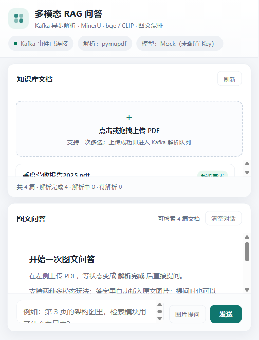
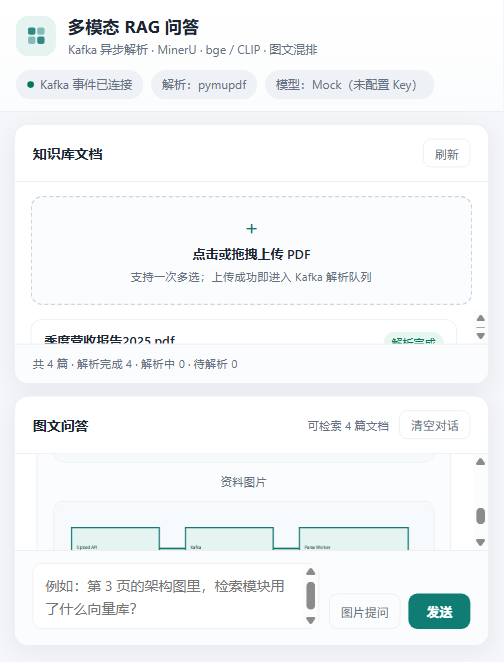

# 多模态 RAG 问答（Kafka + MinerU 复刻版）

参考课程项目 `05-multimodal-rag-chatbot`（Streamlit + Kafka + Milvus + MinerU + bge/CLIP + Qwen-VL）的实现思路，
用 **Kafka 解耦「上传」与「解析」**，重写为一套可直接运行的工程：

- 前端：原生 HTML/JS 单页（上传、状态看板、图文问答），不依赖 Streamlit；
- 服务端：FastAPI 提供 REST + SSE；
- 解析：Kafka 消费者（worker）调用 **MinerU** 解析 PDF，内置 PyMuPDF 兜底后端；
- 向量化：可切换 **bge-small-zh + jina-clip-v2**（真实模型）或 **hash**（零依赖，开发/演示用）；
- 向量库：可切换 **Milvus / Zilliz Cloud** 或 **SQLite**（本地暴力余弦检索）；
- 问答：OpenAI 兼容多模态接口（默认 Qwen-VL），未配置 Key 时自动降级为「检索结果直出」的 Mock。

## 三项功能的落地方式

| 需求 | 实现位置 | 说明 |
| --- | --- | --- |
| ① 前端批量上传 PDF → Kafka → 后端 MinerU 解析并存储 | `frontend/` 上传 → `POST /api/documents` 落盘 + 投递 `rag.parse.request` → `app/worker/main.py` 消费 → `app/parsing/mineru_parser.py` 解析 → 切片/向量化入库 | 上传接口立即返回（不阻塞），单个 PDF 解析百毫秒~分钟级都由 worker 承担 |
| ② 前端显示 待解析 / 解析中 / 解析完成 | `app/status.py` 状态机 + `GET /api/documents` + `GET /api/events`(SSE) | worker 每推进一步都写库 + 投递 `rag.parse.status`，API 用 SSE 实时推给页面，前端另有 5s 轮询兜底 |
| ③ 多模态问答（图文混排 + 图问） | `app/rag/retriever.py`、`app/rag/answerer.py`、`app/api/routes_chat.py` | 答案里的 `` 会被改写成 `/api/assets/<doc>/images/xx.png` 绝对地址，前端渲染成图片；提问可带一张图片，与检索到的图片一起作为 `image_url` 送 VLM |

## 架构

```
                ┌──────────────┐   multipart    ┌───────────────────────────┐
  浏览器 ───────▶│  FastAPI API │───────────────▶│ data/uploads/<doc_id>.pdf │
  (frontend/)    │  :8000       │                └───────────────────────────┘
        ▲        │              │   produce  key=document_id
        │        └──────┬───────┘────────────────────────────┐
        │  SSE          │                                    ▼
        │  /api/events   │                          ┌──────────────────┐
        │        ┌───────▼────────┐   consume        │ Kafka (KRaft)    │
        │        │ StatusConsumer │◀─────────────────│ rag.parse.status │
        │        └───────┬────────┘                  │ rag.parse.request│
        │                │                           │ rag.parse.dlq    │
        │                │                           └────────┬─────────┘
        │                │                                    │ consume (group=rag-parse-workers)
        │                │                          ┌─────────▼─────────┐
        │                └──────────────────────────│  Parse Worker      │
        │                                           │  MinerU / PyMuPDF  │
        │                                           │  切块 → 文本/图像向量 │
        │                                           └─────┬───────┬──────┘
        │                                                 │       │
        │                                     ┌───────────▼──┐ ┌──▼─────────────┐
        └──── /api/chat (SSE) ◀── Retriever ◀──│ Vector Store │ │ SQLite 元数据   │
             图文混排答案        + VLM          │ Milvus/SQLite│ │ app.db         │
                                              └──────────────┘ └────────────────┘
```

为什么用 Kafka（参考项目同样结论）：MinerU 解析一个 PDF 通常要几十秒到几分钟（GPU 上亦是），
不能让 Web 请求同步等待；Kafka 让上传接口与解析进程在不同进程/机器上异步解耦，
并且天然支持「多 worker 横向扩容」「失败重试」「死信队列」「状态事件总线」。
本实现把这些能力都补全了：手动提交位点、重试计数、DLQ、阶段级状态事件。

## 目录结构

```
multimodal-rag-kafka/
├─ app/
│  ├─ config.py            # 全部配置（环境变量，见 .env.example）
│  ├─ status.py            # 状态码 / 中文标签 / 阶段与进度
│  ├─ models.py            # SQLAlchemy: Document / Chunk / ChunkVector
│  ├─ db.py                # SQLite(WAL) 会话
│  ├─ schemas.py           # 接口 JSON 口径
│  ├─ chunking.py          # markdown 切块（保留页码、图片引用、代码块）
│  ├─ kafka_bus.py         # Producer + topic 初始化 + 状态/DLQ 投递
│  ├─ api/                 # FastAPI: documents / chat / events / assets
│  ├─ worker/              # Kafka 消费者 + 解析流水线
│  ├─ parsing/             # MinerU / PyMuPDF 两种解析后端
│  ├─ embedding/           # bge+CLIP 真实模型 / hash 轻量实现
│  ├─ store/               # Milvus / SQLite 向量库
│  └─ rag/                 # 检索、提示词、多模态作答、图片地址改写
├─ frontend/               # index.html + app.css + app.js（无构建、无 CDN）
├─ scripts/
│  ├─ bootstrap.ps1        # 建 venv + 装依赖
│  ├─ download_runtime.py  # 下载便携 JDK17 + Kafka 3.9（华为云镜像）
│  ├─ kafka-up.ps1         # 启动 KRaft 单机 Kafka（无需 Docker/ZooKeeper/系统 Java）
│  ├─ kafka-down.ps1
│  ├─ run-api.ps1 / run-worker.ps1
│  └─ e2e_smoke.py         # 端到端冒烟（造 PDF → 上传 → 状态 → 问答 → 图问）
├─ tests/                  # pytest 单测：切块 / 图片地址 / 哈希向量
├─ requirements.txt        # 运行依赖
├─ requirements-models.txt # 可选：sentence-transformers、torch、pymilvus
├─ docker-compose.yml      # 有 Docker 时可直接起 Kafka
└─ .env.example
```

## 快速开始（Windows，PowerShell）

```powershell
cd multimodal-rag-kafka

# 1) 建 venv 并安装依赖
powershell -ExecutionPolicy Bypass -File scripts\bootstrap.ps1

# 2) 启动本地 Kafka（首次自动下载便携 JDK17 + Kafka 3.9 到 .runtime/，约 300MB）
powershell -ExecutionPolicy Bypass -File scripts\kafka-up.ps1

# 3) 启动 API（含前端）—— 保持窗口
powershell -ExecutionPolicy Bypass -File scripts\run-api.ps1

# 4) 另开一个窗口启动解析 worker
powershell -ExecutionPolicy Bypass -File scripts\run-worker.ps1
```

浏览器打开 <http://127.0.0.1:8000>：左侧拖拽/多选上传 PDF，状态徽标会从 **待解析 → 解析中 → 解析完成** 变化；
右侧提问即可（支持附带图片）。

界面（本机实测截图）：





无 GPU、只想先跑通链路的演示配置：

```powershell
$env:PARSER_BACKEND="pymupdf"   # 用 PyMuPDF 代替 MinerU
$env:EMBED_BACKEND="hash"       # 用哈希向量代替 bge/CLIP
# LLM_API_KEY 留空 -> 自动使用 Mock 作答（直接输出检索片段与图片，便于验证图文混排）
```

Linux / macOS：`python -m venv .runtime/venv && .runtime/venv/bin/pip install -r requirements.txt`，
Kafka 可用 `docker compose up -d kafka` 或自行安装；随后 `uvicorn app.api.main:app`、`python -m app.worker.main`。

## 接入真实 MinerU / 向量模型 / VLM

### MinerU（解析）

```bash
pip install -U mineru
# MinerU 2.x 的 VLM 后端需要一个推理服务（本机部署或远程）
mineru -p data/uploads/x.pdf -o ./tmp -b vlm-http-client -u http://127.0.0.1:30000
```

`.env` 中保留默认即可：

```ini
PARSER_BACKEND=mineru
MINERU_BACKEND=vlm-http-client
MINERU_API_URL=http://127.0.0.1:30000
MINERU_TIMEOUT_SEC=900
```

MinerU 产物 `<out>/<pdf名>/.../<pdf名>.md` + `images/`，以及 `*_content_list.json`（用于回填页码）。
本工程会自动挑出最大的 markdown、用 `content_list.json` 建立「图片 → 页码」「文本前缀 → 页码」映射。

### 向量模型（bge + CLIP）

```bash
pip install -r requirements-models.txt
```

```ini
EMBED_BACKEND=local
TEXT_EMBED_MODEL=BAAI/bge-small-zh-v1.5
CLIP_MODEL=jinaai/jina-clip-v2
HF_ENDPOINT=https://hf-mirror.com   # 国内网络
```

首次运行会下载模型（数百 MB）。`supports_cross_modal=True` 时会额外建立图像向量：
以图搜图（用户上传图片 → CLIP 图像向量）与以文搜图（问题 → CLIP 文本向量）都会生效。

### Milvus / Zilliz Cloud

```ini
VECTOR_STORE=milvus
MILVUS_URI=https://in03-xxxx.serverless.ali-cn-hangzhou.cloud.zilliz.com.cn
MILVUS_TOKEN=xxxx
MILVUS_COLLECTION=rag_chunks
```

collection 自动创建：`id/doc_id/seq/text/page_no/image_rel/text_vector/clip_text_vector/clip_image_vector`，
三个向量字段均为 COSINE + AUTOINDEX。

### 多模态 LLM

```ini
LLM_BACKEND=openai
LLM_BASE_URL=https://dashscope.aliyuncs.com/compatible-mode/v1
LLM_API_KEY=sk-xxxx
LLM_MODEL=qwen-vl-max
```

任何 OpenAI 兼容网关都可用（DashScope、vLLM、OneAPI…）。作答时会把
「检索到的图片（最多 `MAX_IMAGES_TO_LLM` 张，data URI）」+「用户提问图片」+
「带页码/文件名的资料上下文」一起作为多模态消息送入模型，流式输出到前端。

## Kafka 设计

| Topic | 用途 | 分区 | Key |
| --- | --- | --- | --- |
| `rag.parse.request` | 解析任务（file_name/file_path/document_id/attempt） | 3 | `document_id` |
| `rag.parse.status` | 状态事件（document payload + stage） | 3 | `document_id` |
| `rag.parse.dlq` | 超过重试上限的失败任务 | 3 | `document_id` |

- Producer：`acks=all`、`enable.idempotence=true`、`retries` 重试，避免任务丢失；
- Consumer：`group.id=rag-parse-workers`、`enable.auto.commit=false`，业务成功后手动提交位点；
  `max.poll.interval.ms` 按 `MINERU_TIMEOUT_SEC` 放大，避免长解析被踢出消费组；
- 同一 `document_id` 用 key 保证进入同一分区，天然串行，不会两个 worker 同时解析同一文件；
- 失败处理：异常 → 状态回 `待解析` 并带 `attempt+1` 重新投递（默认最多 3 次，退避 `RETRY_BACKOFF_SEC`）；
  超过上限 → 投递 DLQ + 状态置 **解析失败** 并记录错误摘要；
- API 侧 `StatusConsumer` 用「每进程唯一 group + `auto.offset.reset=latest`」只看新事件，
  通过 SSE 扇出给所有浏览器连接（多 API 实例都能各自收到同一份状态流）。

## 状态机

```
        上传成功/重新解析
              │
              ▼
        ┌──────────┐   worker 取到任务   ┌──────────┐
        │ 待解析    │────────────────────▶│ 解析中    │
        │ pending  │                     │ parsing  │
        └────┬─────┘                     └────┬─────┘
             │                               │ 成功
             │ 投递失败                      ▼
             │                        ┌────────────┐
             │                        │ 解析完成    │
             │                        │ completed  │
             ▼                        └────────────┘
        ┌──────────┐   重试超限
        │ 解析失败  │◀──────────────────── 失败（attempt >= PARSE_MAX_ATTEMPTS）
        │ failed   │
        └──────────┘
```

`解析中` 内部还有阶段与进度：解析文档 15% → 切分文本 55% → 向量化 72% → 写入向量库 90% → 解析完成 100%，
前端进度条与状态文案直接取自这些字段。

## API

| 方法 | 路径 | 说明 |
| --- | --- | --- |
| GET | `/api/health` | Kafka 连通性 + 当前后端（parser/embed/store/llm） |
| GET | `/api/system` | topic、group、切片参数、数据目录等运行信息 |
| GET | `/api/documents` | 文档列表（含 status/status_label/stage/progress/chunk_count/image_count/elapsed_ms） |
| POST | `/api/documents` | 批量上传，multipart 字段名 `files`（可多个），返回 `{documents, errors}` |
| GET | `/api/documents/{id}` | 单个文档状态 |
| POST | `/api/documents/{id}/reparse` | 重新解析（重新投递 Kafka） |
| DELETE | `/api/documents/{id}` | 删除文档、切片、向量与解析产物 |
| GET | `/api/events` | SSE：`snapshot`（首帧全量）+ `document_status` + keepalive |
| POST | `/api/chat` | multipart：`message`、`image`（可选）、`doc_ids`（可选，JSON 数组或逗号分隔）、`top_k`；返回 SSE：`meta` → `delta*` → `done` |
| GET | `/api/assets/{doc_id}/{path}` | 解析产物里的图片（带目录穿越防护） |

命令行示例：

```powershell
# 批量上传
curl.exe -X POST http://127.0.0.1:8000/api/documents -F "files=@a.pdf" -F "files=@b.pdf"

# 文本问答（SSE）
curl.exe -N -X POST http://127.0.0.1:8000/api/chat -F "message=架构图里有哪些模块？"

# 图问
curl.exe -N -X POST http://127.0.0.1:8000/api/chat -F "message=这张图和资料哪一页相关？" -F "image=@query.png"
```

## 配置项（`.env.example` 摘要）

| 变量 | 默认 | 说明 |
| --- | --- | --- |
| `PARSER_BACKEND` | `mineru` | `mineru` / `pymupdf` / `local` / `fallback` |
| `MINERU_BACKEND` | `pipeline` | MinerU 的 `-b` 后端；VLM 服务用 `vlm-http-client` |
| `EMBED_BACKEND` | `local` | `local`(bge+CLIP) / `hash` |
| `VECTOR_STORE` | 有 `MILVUS_URI` 则 `milvus`，否则 `sqlite` | `sqlite` / `milvus` |
| `CHUNK_SIZE` | `800` | 切片字符上限（跨页不合并） |
| `TOP_K_TEXT` / `TOP_K_IMAGE` | `5` / `3` | 文本 / 图像召回条数 |
| `MAX_CONTEXT_CHARS` | `6000` | 送模型的资料上限 |
| `SEND_RETRIEVED_IMAGES` | `true` | 是否把检索到的图片一起送 VLM |
| `MAX_IMAGES_TO_LLM` | `3` | 单次作答最多附几张检索图片 |
| `LLM_BACKEND` | `openai` | `openai` / `mock`（无 Key 自动 mock） |
| `LLM_MODEL` | `qwen-vl-max` | 任意 OpenAI 兼容多模态模型 |
| `PUBLIC_BASE_URL` | `http://127.0.0.1:8000` | 答案图片绝对地址前缀，部署时改成对外地址 |
| `PARSE_MAX_ATTEMPTS` | `3` | 解析重试上限（超过进 DLQ，状态置解析失败） |
| `KAFKA_BOOTSTRAP` | `127.0.0.1:9092` | Kafka 地址 |

## 验证

单元测试（切块页码/图片、图片地址改写与目录穿越、哈希向量）：

```powershell
.\.runtime\venv\Scripts\python.exe -m pytest tests -q
# 16 passed
```

端到端冒烟（需 Kafka + API + worker 已启动；脚本会自动生成两篇带图表的中文 PDF）：

```powershell
copy .env.example .env   # 首次可跳过，下面用环境变量演示
$env:PARSER_BACKEND="pymupdf"; $env:EMBED_BACKEND="hash"; $env:LLM_BACKEND="mock"
python scripts\e2e_smoke.py --base-url http://127.0.0.1:8000
```

本机实测结果（Windows 11 + 便携 JDK17 + Kafka 3.9.1 KRaft + PyMuPDF 兜底 + hash 向量 + Mock 作答）：

```
[1/5] 健康检查
  kafka=True parser=pymupdf embed=hash store=sqlite llm=mock
  ✓ Kafka 可连接
[2/5] 生成样例 PDF 并批量上传
  已创建 2 个文档，错误 0 条
  ✓ 批量上传返回 2 个文档
  ✓ 上传后初始状态为 待解析
[3/5] 等待 Kafka worker 解析完成（观察 待解析 → 解析中 → 解析完成）
  [状态] 多模态RAG架构说明.pdf:解析中(15%), 季度营收报告2025.pdf:待解析(0%)
  SSE 事件 13 条，类型：['document_status', 'snapshot']
  ✓ 所有文档解析完成
  ✓ 至少一篇文档被观察到 解析中 状态
  ✓ SSE 实时推送 document_status 事件
  多模态RAG架构说明.pdf: 2 切片 / 1 图片 / 46 ms
  季度营收报告2025.pdf: 2 切片 / 1 图片 / 44 ms
[4/5] 图文混排问答（文本提问，答案里应带原文图片）
  来源数：5，图片数：2
  ✓ 答案中包含 markdown 图片（图文混排）
  ✓ 图片 URL 可直接访问
[5/5] 图问：上传一张图片和问题一起送多模态模型
  has_query_image=True 来源数=5
  ✓ 后端识别到用户上传的图片
[附加] 非 PDF 文件应被拒绝
PASSED：Kafka 上传解析、状态流转、图文混排问答、图问全部通过
```

> 真实 MinerU、bge/CLIP、Milvus、Qwen-VL 的调用路径已实现并做好参数适配，
> 但本机没有 GPU/模型文件与 API Key，因此实机验证使用了上述降级后端（`PARSER_BACKEND=pymupdf`、
> `EMBED_BACKEND=hash`、`LLM_BACKEND=mock`）。切换到真实后端只需按上文改环境变量，代码路径不变。

## 与参考项目的差异

| 维度 | 参考实现 | 本项目 |
| --- | --- | --- |
| 前端 | Streamlit 三个页面 | 单一 FastAPI + 原生 HTML/JS，SSE 实时状态，无 Streamlit 依赖 |
| 状态 | SQLite `filestate` 字段，页面手动刷新 | 状态机 + 阶段进度 + SSE 推送 + 轮询兜底 |
| 失败处理 | 解析异常基本丢弃 | 重试计数 + 重新投递 + DLQ + `解析失败` 状态与错误摘要 |
| 向量库 | Zilliz Cloud Milvus | Milvus/SQLite 可切换，便于本地零依赖运行 |
| 检索 | 仅文本向量 + 命中切片附图 | 文本召回 + 图像召回（跨模态时）+ 按文档过滤 + 页码/来源标注 |
| 问答 | `render_markdown_with_images` 正则切图 | 图片改写为带鉴权路径的 `/api/assets/...` URL，前端统一 markdown 渲染；支持图问 |
| 多 worker | 单进程 | 同一消费组多进程横向扩容，key 保证同文档串行 |

## 已知限制

- 页码回填依赖 MinerU 的 `*_content_list.json`；PyMuPDF 兜底解析自带页码标记，无需该文件；
- `hash` 向量只有字面相似度、没有真正的图文对齐能力（`supports_cross_modal=False`），
  图像召回仅用于「命中切片自带的图」，真实以图搜图需 `EMBED_BACKEND=local`；
- Mock 作答不做语言润色，只把检索片段与图片按引用顺序输出，用于验证链路与前端渲染；
- Windows 下 Kafka 官方 `.bat` 启动脚本对路径/引号敏感，`scripts/kafka-up.ps1` 直接以
  `java -cp <kafka>\libs\* kafka.Kafka <config>` 启动，效果等价且更可控；
- 未做鉴权与多租户，`PUBLIC_BASE_URL` 直接暴露在答案里，公网部署请加反向代理与访问控制。
