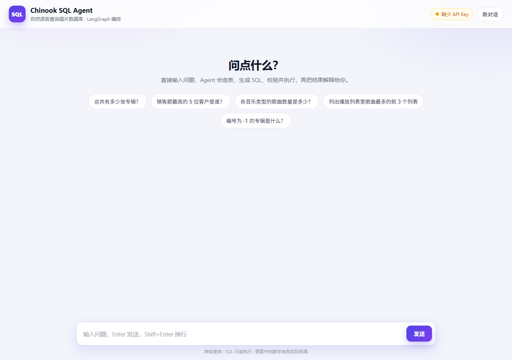
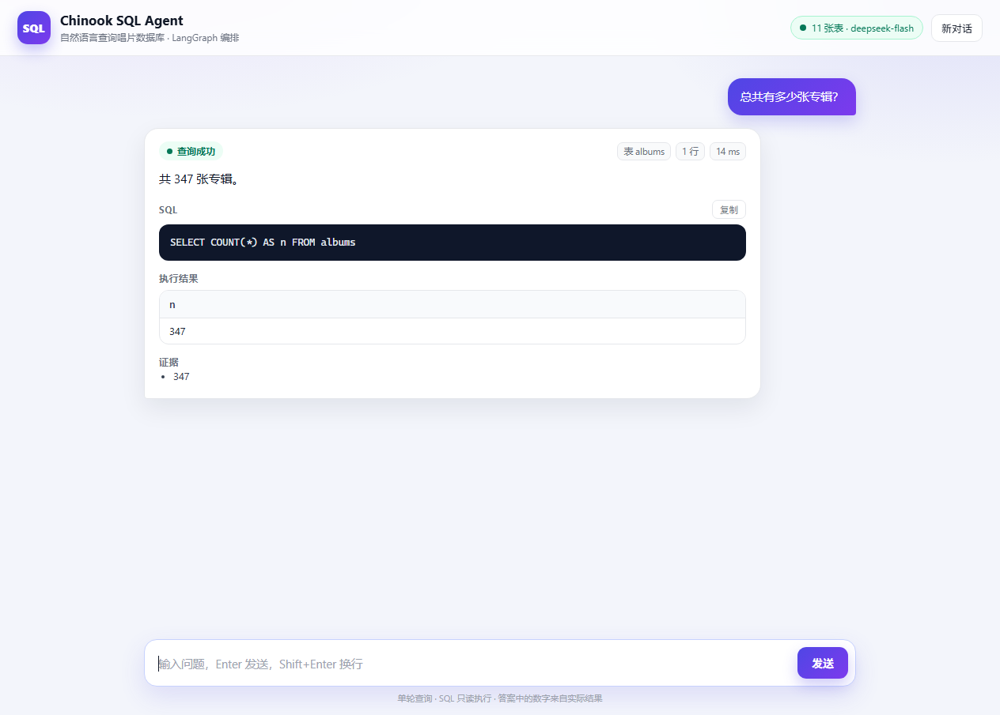
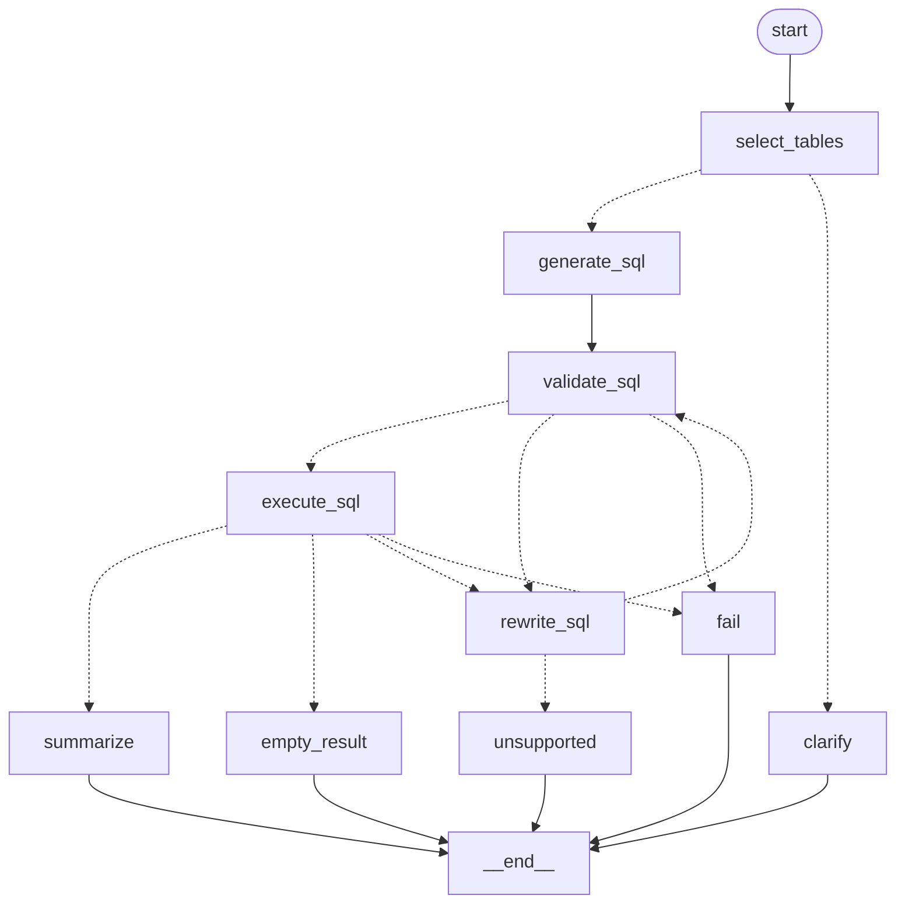

# homework13：LangGraph 版 Chinook SQL Agent

这是 `../task2` 的 **LangGraph 重构版**，并补了一个网页对话界面：用户在浏览器里
输入自然语言问题，后端跑完整的 SQL Agent 流水线，前端展示自然语言答案、生成的
SQL、真实执行结果表格、证据与错误信息。

业务流程不变：**数据库解析 → 选表 → 生成 SQL → 校验 → 修复 → 只读执行 → 结果汇总**。
`task2` 保持原样。

## 界面预览

欢迎页（真实服务，未配置 Key 时状态栏会提示）：



一次查询的结果卡片：答案、SQL、结果表格、证据，顶部是状态与耗时：



> 结果页截图由固定 Agent 输出驱动，避免截图依赖外部模型；SQL 仍由真实执行器
> 在 `ref/chinook.db` 上运行，所以 347 是数据库的真实结果。

## 快速开始

```bash
cd homework13
pip install -e ".[web]"           # 安装 langgraph + fastapi + uvicorn

export OPENAI_API_KEY=sk-...      # DeepSeek / DashScope 的 Key
export OPENAI_BASE_URL=https://api.deepseek.com   # 可选，默认就是这个

sql-agent-web                     # 默认 http://127.0.0.1:8000
```

也可以不装脚本，直接跑模块：

```bash
PYTHONPATH=src python -m sql_agent.webapp.server --port 8000
```

打开 <http://127.0.0.1:8000>，输入问题即可。API 文档在 `/docs`。

命令行方式仍然可用：

```bash
PYTHONPATH=src python -m sql_agent "总共有多少张专辑？"
```

## 前端功能

- **对话式交互**：输入框 Enter 发送、Shift+Enter 换行；历史消息保留在页面上，可点“新对话”清空。
- **状态可视化**：查询成功 / 无匹配数据 / 需要澄清 / 无法回答 / 执行失败，用不同颜色标识。
- **结果展示**：自然语言答案、可复制的 SQL、真实结果表格（横向/纵向滚动）、证据与注意事项。
- **调试信息**：命中表、返回行数、修复次数、服务端耗时；失败时展开“错误详情”。
- **无构建步骤**：原生 HTML/CSS/JS，由 FastAPI 直接托管，不依赖 npm 或 CDN。

说明：这是**单轮问答**。聊天窗口只保留展示历史，服务端不保存会话，也不做多轮
上下文追问（与 `docs/agent-design.md` 的非目标一致）。

## API

| 方法 | 路径 | 说明 |
| --- | --- | --- |
| `GET` | `/` | 单页前端 |
| `GET` | `/api/health` | 数据库表数、模型名、是否配置 Key |
| `POST` | `/api/query` | `{"question": "..."}` → 答案 + SQL + 结果行 + 耗时 |
| `GET` | `/docs` | FastAPI 自动生成的接口文档 |

`POST /api/query` 返回 `WorkflowOutput` 的全部字段，并额外附带 `elapsed_ms`：

```json
{
  "question": "总共有多少张专辑？",
  "answer": "共 347 张专辑。",
  "sql": "SELECT COUNT(*) AS n FROM albums",
  "tables": ["albums"],
  "row_count": 1,
  "truncated": false,
  "columns": ["n"],
  "rows": [["347"]],
  "repair_attempts": 0,
  "evidence": ["347"],
  "caveats": [],
  "error": null,
  "status": "ok",
  "elapsed_ms": 1840
}
```

未配置 `OPENAI_API_KEY` 时接口返回 `503`，前端会把它渲染成一条错误消息。

## 图结构



实线是固定边，虚线是条件边；修复最多 3 次，空结果不调用汇总模型。详见
[`docs/langgraph-workflow.md`](docs/langgraph-workflow.md)。

## 代码结构

```text
src/sql_agent/
  graph.py            # LangGraph StateGraph：节点、条件边、路由、汇总
  state.py            # GraphState（TypedDict）
  workflow.py         # 薄封装：输入校验 + WorkflowOutput 组装
  llm.py              # StructuredAgent：消息构造、工具绑定、Pydantic 解析
  models.py           # 数据契约
  agents/             # 四个模块级 Agent + 提示词
  db/                 # catalog / validator / executor（只读）
  webapp/
    server.py         # FastAPI：/api/query、/api/health、静态资源
    static/
      index.html      # 单页布局
      styles.css      # 样式
      app.js          # 聊天交互与结果渲染（原生 JS）
docs/
  langgraph-workflow.md   # 节点、状态、路由、迁移说明
  agent-design.md         # 原始设计文档（v0.2 变更说明在开头）
  webapp-*.png            # 界面截图
```

## 测试

```bash
pytest -q     # 42 passed，不需要 API Key（LLM 全部 mock）
```

覆盖范围：正常路径、校验失败修复、执行期错误修复、空结果、非法表重试、修复预算
耗尽、澄清、无法修复，以及 Web 的首页/静态资源、健康检查、成功查询、空问题、
缺 Key、模型异常路径。`ruff check src tests` 无告警。

## 与 task2 的主要差异

| 项目 | task2 | homework13 |
| --- | --- | --- |
| 编排 | `workflow.py` 的 `while` + `try/except` | `graph.py` 的 `StateGraph` |
| 状态 | Pydantic `QueryState` | `TypedDict` `GraphState` |
| 模型调用 | `prompt \| ChatOpenAI.bind_tools()` | 节点内 `await model.ainvoke([...])` |
| 提示词 | `ChatPromptTemplate` | `SystemMessage` + `HumanMessage` |
| 可视化 | 无 | `draw_mermaid()` |
| 入口 | CLI | CLI + Web 对话界面 |

模型客户端仍是 `langchain-openai` 的 `ChatOpenAI`：LangGraph 不提供模型层，只负责
编排。`ref/` 目录原样保留，其中的 notebook 仍然硬编码了一把 DashScope Key，
不要复用或提交。

## 配置

| 环境变量 | 默认值 | 说明 |
| --- | --- | --- |
| `OPENAI_API_KEY` | — | 必填，DeepSeek / DashScope Key |
| `OPENAI_BASE_URL` | `https://api.deepseek.com` | OpenAI 兼容端点 |
| `SQL_AGENT_MODEL` | `deepseek-flash` | 选表 / 生成 / 改写模型 |
| `SQL_AGENT_SUMMARY_MODEL` | `deepseek-flash` | 汇总模型 |
| `SQL_AGENT_TOOL_CHOICE` | `auto` | 思考模式模型必须用 `auto` |
| `SQL_AGENT_MAX_REPAIR_ATTEMPTS` | `3` | 修复预算（校验与执行共享） |
| `SQL_AGENT_RECURSION_LIMIT` | `50` | LangGraph 单次执行的最大步数 |
| `SQL_AGENT_MAX_ROWS` | `200` | 执行层返回行数上限 |
| `SQL_AGENT_MAX_SUMMARY_ROWS` | `50` | 进入汇总 prompt 的行数 |
| `SQL_AGENT_QUERY_TIMEOUT` | `5.0` | 单条 SQL 执行超时（秒） |
| `SQL_AGENT_WEB_HOST` | `127.0.0.1` | Web 监听地址（默认只开本机） |
| `SQL_AGENT_WEB_PORT` | `8000` | Web 监听端口 |

## 安全与边界

- Web 默认只监听 `127.0.0.1`，不把数据库查询能力暴露到局域网；
- 前端不接触 API Key，所有模型调用都在后端；
- SQL 仍然只读执行（`mode=ro` + `PRAGMA query_only` + `EXPLAIN` 校验）；
- 问题长度限制 2000 字符，接口单轮、无状态，不接收任意 SQL。
