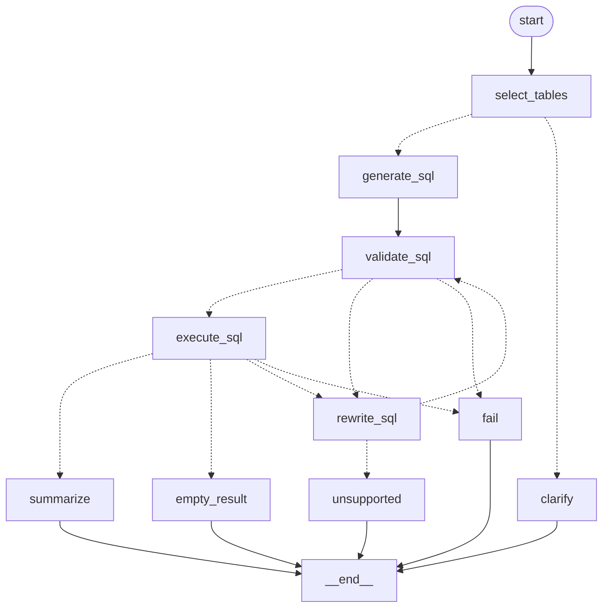

# LangGraph 版 SQL Agent：图结构说明

> 版本：v0.2（2026-11-06）
> 对应代码：`src/sql_agent/graph.py`、`src/sql_agent/state.py`
> 原 LangChain LCEL 版：`../task2`

## 1. 为什么用 LangGraph

`task2` 把流程写在 `workflow.py` 的 `while` 循环里，用 LangChain 的
`prompt | model.bind_tools(...)` 组装模型调用。这样能跑，但有两个问题：

1. 编排逻辑、节点实现、重试计数混在一个 400 多行的方法里，读起来要不断跳转；
2. 流程不可视化，也没法单独重放某一步或换一种路由。

`homework13` 把编排迁移到 LangGraph 的 `StateGraph`：

- 每个阶段是一个**具名节点**，输入输出都是状态字典的增量；
- 分支和循环写成**条件边**，修 SQL 的闭环在图上直接看得到；
- 重试预算仍然由状态里的 `repair_attempts` 控制，不依赖框架的隐式行为；
- 保留 `SQLAgentWorkflow` 作为薄封装，CLI 和测试的调用方式不变。

**没有换掉的部分**：模型客户端仍是 `langchain_openai.ChatOpenAI`。LangGraph
只负责编排，不提供模型层；`ChatOpenAI` 是它接入 OpenAI 兼容端点的标准方式。
换掉的是 LCEL 的 `ChatPromptTemplate | RunnableSequence` 组合方式。

## 2. 图结构



`graph.draw_mermaid()` 会从编译后的图直接导出上面的定义，见
`SQLAgentGraph.draw_mermaid()`。

## 3. 状态

状态定义在 `state.py`，用 `TypedDict` 描述，`total=False`：

| 字段 | 写入节点 | 说明 |
| --- | --- | --- |
| `question` | 入口 | 用户问题，节点里按数据使用 |
| `selection` | `select_tables` | `TableSelection`，含澄清标记 |
| `tables` / `schema_context` | `select_tables` | 选中的表与详细 schema |
| `sql` | `generate_sql` / `rewrite_sql` / `validate_sql` | 当前 SQL（校验通过后存规范化版本） |
| `attempts` | `generate_sql` / `rewrite_sql` / `validate_sql` | 所有 SQL 尝试及错误，供改写参考 |
| `validation` | `validate_sql` / `execute_sql` | 校验或执行错误 |
| `execution` | `execute_sql` | 只读执行结果 |
| `repair_attempts` | `rewrite_sql` | 已用修复次数，路由据此判断预算 |
| `cannot_fix` / `cannot_fix_reason` | `rewrite_sql` | 改写 Agent 判定无法修复 |
| `answer` | `summarize` / `empty_result` / `clarify` / `fail` / `unsupported` | `FinalAnswer` |
| `status` | 终止节点 | `ok` / `empty` / `clarified` / `unsupported` / `failed` |
| `error` | `fail` / `execute_sql` | 程序错误；业务性“无法回答”不带 error |

节点只返回自己改动的字段，例如 `select_tables` 返回
`{"selection": ..., "tables": ..., "schema_context": ...}`，其余字段由
LangGraph 保留。`attempts` 不用 reducer，节点显式返回完整列表，避免隐式合并。

## 4. 节点职责

| 节点 | 类型 | 职责 | 失败去向 |
| --- | --- | --- | --- |
| `select_tables` | LLM | 选表；非法表名/不连通时重试 1 次 | `clarify` |
| `generate_sql` | LLM | 在已选表内生成一条 SELECT | `validate_sql` |
| `validate_sql` | 代码 | 安全门禁 + `EXPLAIN` 编译 | `execute_sql` / `rewrite_sql` / `fail` |
| `execute_sql` | 代码 | 只读执行、超时、行数与单元格截断 | `summarize` / `empty_result` / `rewrite_sql` / `fail` |
| `rewrite_sql` | LLM | 带错误码和历史修复 SQL | `validate_sql` / `unsupported` |
| `summarize` | LLM | 结果转中文答案，失败降级为表格 | `__end__` |
| `empty_result` | 代码 | 固定回答“未查询到符合条件的数据” | `__end__` |
| `clarify` | 代码 | 返回选表 Agent 的澄清问题 | `__end__` |
| `fail` | 代码 | 修复预算耗尽 | `__end__` |
| `unsupported` | 代码 | 数据库无法回答该问题 | `__end__` |

## 5. 路由与重试预算

条件边函数都是 `SQLAgentGraph` 的方法：

- `route_after_select`：有澄清标记或没有表 → `clarify`，否则 `generate_sql`；
- `route_after_validate`：校验通过 → `execute_sql`；失败且
  `repair_attempts < max_repair_attempts` → `rewrite_sql`，否则 `fail`；
- `route_after_execute`：执行成功且无行 → `empty_result`；有行 → `summarize`；
  执行报错 → 按预算进入 `rewrite_sql` 或 `fail`；
- `route_after_rewrite`：`cannot_fix` → `unsupported`，否则回到 `validate_sql`。

预算语义与 `task2` 一致：初始 SQL 不占预算，最多改写 3 次，校验失败和执行
失败共享这 3 次。图的最大步数由 `SQL_AGENT_RECURSION_LIMIT`（默认 50）限制，
即使路由写错也不会死循环。

## 6. 与 LangChain 版的差异

| 项目 | task2（LangChain LCEL） | homework13（LangGraph） |
| --- | --- | --- |
| 编排 | `workflow.py` 里的 `while` + `try/except` | `StateGraph` 节点 + 条件边 |
| 模型调用 | `prompt \| ChatOpenAI.bind_tools(...)` | 节点直接 `await model.ainvoke([SystemMessage, HumanMessage])` |
| 提示词 | `ChatPromptTemplate` | `StructuredAgent.build_messages()` |
| 状态 | Pydantic `QueryState` | `TypedDict` `GraphState` |
| 分支 | 代码 `if` | `add_conditional_edges` |
| 可视化 | 无 | `draw_mermaid()` |
| 对外入口 | `SQLAgentWorkflow.run()` | 不变（内部改成调图） |

`StructuredAgent` 仍然存在，但不再是 LangChain `Runnable`：它只负责构造消息、
绑定工具、解析 Pydantic 结果，由 LangGraph 节点调用。

## 7. 运行与调试

```bash
cd homework13
pip install -e ".[web]"                 # langgraph + fastapi + uvicorn
export OPENAI_API_KEY=sk-...
PYTHONPATH=src python -m sql_agent "总共有多少张专辑？"
sql-agent-web                           # http://127.0.0.1:8000
pytest -q                               # 42 个离线测试（含 Web API）
```

查看图结构：

```python
from sql_agent.workflow import SQLAgentWorkflow
print(SQLAgentWorkflow().agent_graph.draw_mermaid())
```

进一步可以接入 `MemorySaver` 做断点续跑，或用 `graph.astream()` 把每个节点的
增量事件推给前端；当前版本不需要多轮对话，所以没有启用 checkpoint。

## 8. Web 层

`src/sql_agent/webapp/server.py` 把图包装成 Web 服务：

- 启动时（FastAPI lifespan）创建一个 `SQLAgentWorkflow`，所有请求复用同一个图；
  catalog 本身还有进程级缓存，所以 `POST /api/query` 不会重复解析数据库。
- `POST /api/query` 接收 `{"question": ...}`，调用 `workflow.run()`，返回
  `WorkflowOutput` 的全部字段（含 `columns` / `rows`）并附带 `elapsed_ms`。
- `GET /api/health` 返回表数量、模型名、是否配置 Key；`GET /` 返回单页前端，
  `/docs` 是 FastAPI 自动生成的接口文档。
- 缺 `OPENAI_API_KEY` 时直接返回 503，前端渲染成一条错误消息，不会把
  Key 缺失伪装成“查询失败”。

前端是 `static/` 下的原生 HTML/CSS/JS，没有构建步骤，也没有 CDN 依赖：

| 文件 | 作用 |
| --- | --- |
| `index.html` | 顶栏、聊天区、示例问题、输入框 |
| `styles.css` | 气泡、结果卡片、SQL 代码块、结果表格、响应式 |
| `app.js` | 调 `/api/query`，用 `textContent` 构建 DOM，渲染答案/SQL/表格/证据 |

截图见 `docs/webapp-welcome.png` 和 `docs/webapp-result.png`。

