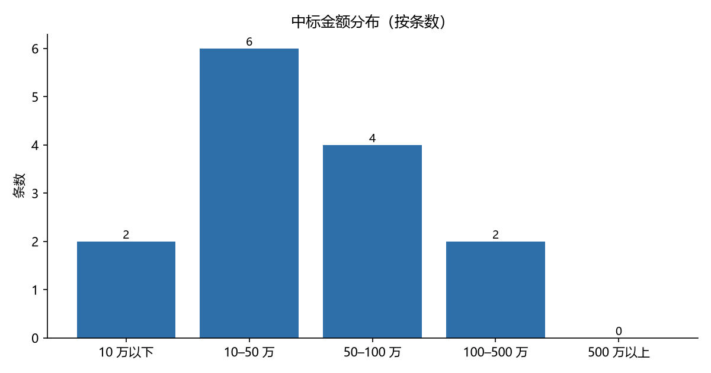
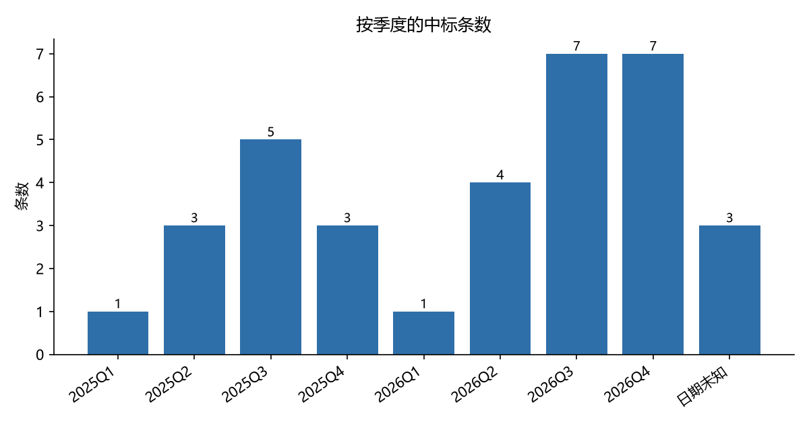
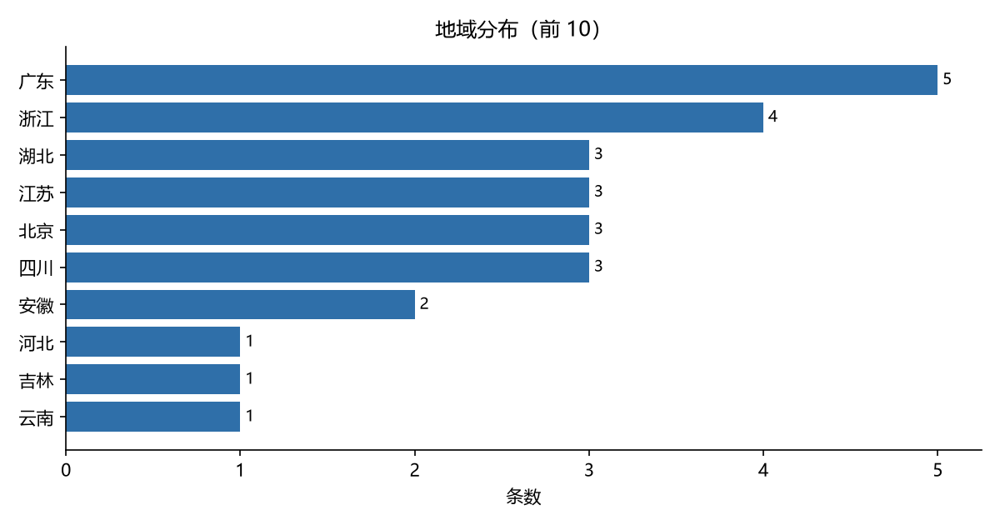

# ESG 相关招投标回顾报告

**统计区间：** 2024-11-27 至 2026-11-26　|　**出具日期：** 2026-11-26　|　**样本：** 中标记录 34 条，其中披露金额 14 条

> **结论**：近两年 ESG 相关服务采购里，碳核查与碳盘查是条数最多的一类（34 条中标记录里占 16 条），购买方主要是省级生态环境部门 [S17][S19][S28][S29]；ESG 报告编制与咨询的单笔金额跨度最大（23 万到 168 万），央企和国企是主要买方 [S2][S6][S7][S13][S30]。赢家分三类：认证机构拿碳核查，ESG 咨询公司拿报告与体系项目，会计师事务所只出现在多标段项目的单个标段里 [S19][S23][S31]。

## 一、样本说明

- 关键词范围：ESG、可持续发展、双碳三类词族，外加能源审计、清洁生产审核、绿色工厂等延伸词；排除规则见附录。
- 检索 30 次，原始结果 176 条，去重后 159 条；关键词筛选保留 130 条，按标题剔除政策文件、已发布的报告、服务商广告等 76 条后，进入抓取 54 条。检索式与各条命中情况见 `search_plan.md`。
- 大模型判定为 ESG 项目的 53 条：中标类 34 条，招标类 19 条。中标类 34 条来自 32 条公告，湖北 2025 年碳核查和运达股份 ESG 咨询各拆成两个包/标段 [S23][S24][S28][S29]。
- 样本来自公开检索，不是全量；2024 年末的中标公告几乎没有检索到，中标记录集中在 2025 年 3 月以后 [S31]。金额统计只基于披露了金额的 14 条记录。
- 打开原文核实 42 条，仅依据搜索摘要 11 条（脚本抓取失败 8 条、正文为空 1 条、反爬占位页 2 条）[S18][S25][S31][S32][S34]；另用网页读取工具核对 2 条 [S2][S11]。
- 中标候选人公示、预成交公示阶段的记录 7 条，金额和中标人仍可能变动 [S1][S4][S6][S7][S13][S23][S24]。

## 二、总体情况

| 指标 | 数值 | 说明 |
|---|---|---|
| 中标记录数 | 34 条 | 来自 32 条公告 [S23][S24][S28][S29] |
| 披露金额的记录数 | 14 条 | 占 34 条的 41.2% [S8] |
| 金额合计（万元） | 1,138.77 | 14 条合计 [S12] |
| 均值 / 中位数（万元） | 81.34 / 42.45 | 均值被一笔 446.27 万的评估项目拉高 [S12] |
| 最大单笔（万元） | 446.27 | 2026年工业企业绿色生产水平评估服务项目，采购人未能读到 [S12] |
| 招标类记录数 | 19 条 | 其中 4 条截至 2026-11-26 仍在报名期内，见第七章 [S35][S36][S37][S38] |

披露金额的 14 条里，4 条在 100 万以上（湖北碳核查包 4、包 5，神华 ESG 治理体系，绿色生产水平评估）[S13][S28][S29][S12]；其余 10 条在 80 万以下 [S1][S8][S11][S16][S20][S21][S25][S26][S30][S32]。

## 三、热点主题

本章最值得关注的是：碳核查与盘查条数最多但单笔价格集中在 30 万到 100 万；ESG 报告编制与咨询条数少，却出现了央企百万级合同 [S13][S28][S29]。

| 项目类型 | 条数 | 金额合计（万元） | 均值（万元） | 典型项目 |
|---|---|---|---|---|
| 碳核查与盘查 | 16 | 386.66 | 64.44 | 江苏 2025–2027 年度碳排放核查 [S19]；湖北 2025 年碳核查包 4、包 5 [S28][S29]；光大银行全行碳盘查 78 万 [S1] |
| ESG咨询与体系 | 6 | 6.68 | 6.68 | 浙江创新投资 ESG 体系规划及报告 [S2]；招商港口 2026 年 ESG 咨询 [S6]；运达股份 ESG 专项提升两个标段 [S23][S24]；河北农贸 ESG 咨询 6.68 万 [S32] |
| 能源与节能 | 4 | 41.26 | 13.75 | 西苑医院能源审计诊断 12 万 [S20]；北京能源审计报告评估 24.5 万 [S21]；成都、南京清洁生产审核 [S14][S16] |
| ESG报告编制 | 3 | 191.00 | 95.50 | 中国神华 ESG 治理体系优化及报告编制 168 万 [S13]；深圳环境水务 2024 年 ESG 报告 23 万 [S30]；南航进出口 ESG 报告编制 [S7] |
| 绿色认证 | 3 | 446.27 | 446.27 | 工业企业绿色生产水平评估 446.27 万 [S12]；四川绿色工厂动态管理 [S3]；江苏产品碳标识认证 [S34] |
| 数字化平台 | 1 | 66.90 | 66.90 | 粤港澳大湾区碳足迹核算平台和模型开发（三期）A 包 66.9 万 [S25] |
| 碳资产与交易 | 1 | 0.00 | 样本不足 | 色达县 CCER 造林碳汇项目开发（二次）[S22] |

说明：

- 碳核查与盘查是唯一条数达到两位数的类型。购买方里 7 条是省级或市级生态环境部门 [S8][S11][S17][S19][S28][S29][S31]，1 条是发改委 [S5]；其余是银行、煤矿、医院等自采 [S1][S15][S33]；5 条采购人没有读到 [S9][S10][S18][S26][S27]。湖北省生态环境厅一份公告拆成包 4、包 5 两条，贡献了该类型 386.66 万里的 197.16 万 [S28][S29]；去掉这两条后该类型均价会明显低于 64.44 万。
- ESG 咨询与体系 6 条里只有河北农贸一条披露金额（6.68 万）[S32]；浙江创新投资的成交结果是图片、读不到金额 [S2]，中刚、招商港口是候选人公示 [S4][S6]，运达是预成交公示 [S23][S24]。均值 6.68 万不代表这一类型的价格水平。
- 绿色认证的 446.27 万全部来自一条采购人不明的评估项目 [S12]，其余两条没有金额 [S3][S34]，同样不宜按 446.27 万推断绿色工厂咨询的价格。
- 数字化平台、碳资产与交易的记录数各只有 1 条，样本不足，不下结论 [S22][S25]。

## 四、中标金额分布

| 金额档位（万元） | 条数 | 占比 | 代表项目 |
|---|---|---|---|
| 10 万以下 | 2 | 14.3% | 河北农贸 ESG 咨询 6.68 万 [S32]；高淳区清洁生产审核 4.76 万 [S16] |
| 10–50 | 6 | 42.9% | 深圳环境水务 ESG 报告 23 万 [S30]；芜湖碳足迹 26.6 万 [S8]；青岛碳足迹第 2 包 39.9 万 [S11]；重点领域碳足迹核算 45 万 [S26] |
| 50–100 | 4 | 28.6% | 粤港澳大湾区碳足迹平台 66.9 万 [S25]；光大银行碳盘查 78 万 [S1]；湖北碳核查包 5、包 4 [S29][S28] |
| 100–500 | 2 | 14.3% | 中国神华 ESG 治理体系 168 万 [S13]；绿色生产水平评估 446.27 万 [S12] |
| 500 以上 | 0 | 0% | 无 [S12] |

按项目类型看价格带（最小值到最大值，只算披露金额的记录）：

| 项目类型 | 价格带（万元） | 披露条数 | 备注 |
|---|---|---|---|
| 碳核查与盘查 | 26.6 – 99.16 | 6 | 含 2 条同一公告的包 [S8][S28][S29] |
| ESG报告编制 | 23.00 – 168.00 | 2 | 168 万一条是 ESG 治理体系加报告编制 [S13][S30] |
| 能源与节能 | 4.76 – 24.50 | 3 | 价格最低的类型 [S16][S20][S21] |
| 数字化平台 | 66.90 – 66.90 | 1 | 样本不足 [S25] |
| 绿色认证 | 446.27 – 446.27 | 1 | 样本不足 [S12] |
| ESG咨询与体系 | 6.68 – 6.68 | 1 | 样本不足 [S32] |
| 碳资产与交易 | 未披露 | 0 | 样本不足 [S22] |

## 五、时间与地域

| 季度 | 条数 | 金额合计（万元） | 备注 |
|---|---|---|---|
| 2025Q1 | 1 | 0.00 | 云南碳核查 [S31] |
| 2025Q2 | 3 | 220.16 | 湖北碳核查两个包 197.16 万 [S28][S29]；深圳环境水务 ESG 报告 23 万 [S30] |
| 2025Q3 | 5 | 111.90 | 粤港澳大湾区碳足迹平台、重点领域碳足迹两条披露金额 [S25][S26]；运达两个标段、合肥碳足迹无金额 [S23][S24][S27] |
| 2025Q4 | 3 | 36.50 | 能源审计诊断、能源审计评估、CCER 开发 [S20][S21][S22] |
| 2026Q1 | 1 | 0.00 | 江苏碳核查 [S19] |
| 2026Q2 | 4 | 4.76 | 只有高淳清洁生产审核一条披露金额 [S16]；吉林、宁夏碳核查和湖北 2026 包 6 无金额 [S15][S17][S18] |
| 2026Q3 | 7 | 680.77 | 绿色生产评估 446.27 万和神华 168 万都在这一季 [S12][S13]；另有青岛、芜湖碳足迹和成都清洁生产审核 [S8][S11][S14] |
| 2026Q4 | 7 | 78.00 | 光大银行碳盘查 78 万 [S1]；其余 6 条没有金额 [S2][S3][S4][S5][S6][S7] |
| 日期未知 | 3 | 6.68 | 河北农贸、省立医院、江苏碳标识，公告没有日期 [S32][S33][S34] |

- 2026 年下半年两个季度条数最多，各 7 条；2026Q4 的 7 条里 6 条没有金额，季度之间的金额合计不可比 [S1][S2][S3][S4][S5][S6][S7]。
- 2024 年 12 月 31 日只有 1 条招标公告，没有中标记录 [S50]。

省份前 10（按条数）：广东 5、浙江 4、湖北 3、江苏 3、北京 3、四川 3、安徽 2、河北 1、吉林 1、云南 1 [S1][S4][S5][S8][S9][S16][S17][S18][S19][S32]。

- 广东 5 条集中在深圳（碳核算、碳足迹平台、ESG 咨询、南航、能源审计）[S5][S6][S7][S25][S53]。
- 湖北 3 条里 2 条是同一份公告的包 4、包 5，另一条是 2026 年包 6 的成交结果 [S18][S28][S29]。
- 采购人类型：企业 12 条、政府机关 12 条、国企 6 条、事业单位 3 条、金融机构 1 条 [S1][S3][S5][S13][S20]。"企业"里有 7 条采购人名称没有读到，所有制不明 [S9][S10][S12][S18][S26][S27][S34]。

## 六、中标机构格局

| 中标机构 | 中标次数 | 擅长类型 | 代表项目 |
|---|---|---|---|
| CTI华测认证 | 2 | 碳核查、碳标识认证 | 云南重点企业碳核查 [S31]；江苏 2026 年产品碳标识认证 [S34] |
| 中国船级社质量认证有限公司 | 2 | 碳盘查、CCER | 光大银行全行碳盘查 78 万（第一候选人）[S1]；色达县 CCER 开发 [S22] |
| 中国质量认证中心 | 1 | 碳核查 | 江苏 2025–2027 年度碳排放核查 [S19] |
| 责任云（北京）控股集团有限公司 | 1 | ESG 咨询与报告 | 中国神华 ESG 治理体系 168 万（候选人公示）[S13] |
| 盟浪可持续数字科技（深圳） | 1 | ESG 咨询 | 招商港口 2026 年 ESG 咨询 [S6] |
| 责扬天下（北京）管理顾问有限公司 | 1 | ESG 报告编制 | 南航进出口 ESG 报告编制 [S7] |
| 德勤华永会计师事务所 | 1 | ESG 咨询（双碳） | 运达股份 ESG 专项提升标段 1 [S23] |
| 上海易碳数字科技有限公司 | 1 | 碳足迹平台 | 粤港澳大湾区碳足迹平台 A 包 66.9 万 [S25] |
| 中春环保科技（上海）有限公司 | 1 | 碳足迹核算 | 芜湖碳足迹核算 26.6 万 [S8] |
| 深圳绿色交易所有限公司 | 1 | ESG 报告编制 | 深圳环境水务 ESG 报告 23 万 [S30] |

- 认证机构是碳核查与盘查的主要赢家：中国质量认证中心、CTI华测认证、中国船级社质量认证、方圆标志认证、中节能咨询分掉了湖北、江苏、云南、青岛的核查与核算包 [S11][S19][S28][S29][S31]。青岛一条的中标方写作"中国质量认证中心有限公司,山东省生态环境规划研究院"联合体，没有并入"中国质量认证中心"的计数 [S11]。
- ESG 报告与咨询由咨询公司拿下：责任云、责扬天下、盟浪 [S6][S7][S13]。
- 会计师事务所只出现一次：德勤华永拿下运达股份标段 1（气候风险管理&双碳咨询），同公告的供应链 ESG 标段由颖投信息科技拿下 [S23][S24]。
- 软件和数据公司出现两次：上海易碳（碳足迹平台）[S25]、擎工互联（合肥碳足迹核算）[S27]；碳资产管理公司没有作为中标人出现 [S22]。

## 七、进行中的招标机会

招标类记录 19 条，截至 2026-11-26 仍在报名期内的只有 4 条 [S35][S36][S37][S38]，其余 15 条截止时间已过或公告日期无法确认 [S39][S40][S41][S42][S43][S44][S45][S46][S47][S48][S49][S50][S51][S52][S53]。

| 状态 | 截止时间 | 项目 | 招标人 | 预算或最高限价 | 类型 | 来源 |
|---|---|---|---|---|---|---|
| 进行中 | 2026-12-03 | 2026年度ESG中英双版报告编制和版面设计服务 | 未披露 | 未披露 | ESG报告编制 | [S35] |
| 进行中 | 2026-11-30 | 南山区双碳评估技术服务项目 | 深圳市生态环境局南山管理局 | 250 万元 | 双碳规划 | [S37] |
| 进行中 | 2026-11-30 | 冀中能源章村矿矸石热电厂2026年度清洁生产审核项目 | 冀中能源章村矿矸石热电厂 | 未披露 | 能源与节能 | [S36] |
| 进行中 | 未披露 | 华夏理财2026年ESG可持续投资外部数据引入项目 | 华夏理财有限责任公司 | 未披露 | ESG咨询与体系 | [S38] |
| 已截止 | 2026-11-06 | ESG体系规划及编制2026年度报告服务项目（已成交） | 浙江省创新投资集团有限公司 | 未披露 | ESG报告编制 | [S39] |
| 已截止 | 2026-11-02 | 物流公司2026-2027年可持续发展暨ESG报告采购项目 | 南方航空物流股份有限公司 | 未披露 | ESG报告编制 | [S40] |
| 已截止 | 未披露 | 中国光大银行2024-2026年全行碳盘查服务采购项目（已出候选人公示） | 中国光大银行 | 未披露 | 碳核查与盘查 | [S41] |
| 已截止 | 2026-11-02（摘要） | 开展动力电池碳足迹管理支撑工作 | 未披露 | 未披露 | 碳核查与盘查 | [S42] |
| 已截止 | 2026-09-04 | 武商集团2026年度ESG报告编制及合规管理数字化平台服务项目 | 武商集团股份有限公司 | 含税 20 万元 | ESG报告编制 | [S43] |
| 已截止 | 未披露 | 2026年碳排放第三方核查项目包9（其他行业）（武汉） | 未披露 | 未披露 | 碳核查与盘查 | [S44] |
| 已截止 | 2026-10-23 | 东方特钢国家级绿色工厂申报咨询服务 | 常州东方特钢有限公司 | 未披露 | 绿色认证 | [S51] |
| 已截止 | 2025-10-27 | 2025年能源审计报告评估服务（已出中选结果） | 北京经济技术开发区经济发展局 | 人民币25万元 | 能源与节能 | [S45] |
| 已截止 | 2025-09-30 | 中粮会展2025年度ESG报告编制项目 | 中粮会展（北京）有限公司 | 未披露 | ESG报告编制 | [S46] |
| 已截止 | 未披露 | 哈药集团ESG报告编制与管理服务 | 哈药集团股份有限公司 | 未披露 | ESG报告编制 | [S47] |
| 已截止 | 2025-05-08 | 湖北省生态环境厅2025年碳排放第三方核查项目（已出结果） | 湖北省生态环境厅 | 1100 (万元) | 碳核查与盘查 | [S48] |
| 已截止 | 2025-04-21 | 深圳市机关事务管理局2025年度能源审计项目 | 深圳市机关事务管理局 | 人民币213,000.00元 | 能源与节能 | [S53] |
| 已截止 | 2025-04-08 | 2025年松江区公共机构能源审计项目 | 上海市松江区机关事务管理局 | 包件一 47.625 万元，包件二 48.375 万元 | 能源与节能 | [S49] |
| 日期不明 | 未披露 | 云南九九彩印2026-2028年绿色工厂维护咨询采购项目 | 云南九九彩印有限公司 | 未披露 | 绿色认证 | [S52] |
| 已截止 | 2025-01-07 | 重庆水务环境控股集团等三家公司ESG报告编制服务集中采购 | 重庆水务环境控股集团有限公司 | 未披露 | ESG报告编制 | [S50] |

- 招标预算与中标金额的对照只有 3 组可比：湖北碳核查预算 1100 万，包 4、包 5 成交 99.16 万、98.00 万 [S28][S29][S48]；北京能源审计评估预算 25 万、中选 24.5 万 [S21][S45]；光大银行碳盘查预算未披露、第一候选人 78 万 [S1][S41]。

## 八、建议

- 客户是买方：ESG 报告编制的可比价格是 23 万到 168 万，差别在于是否含治理体系、评级支持和中英文版 [S13][S30]；只做报告编制可参考 23 万的中标价 [S30] 和 20 万的预算 [S43]，含体系建设和评级支持则要按百万级准备 [S13]。碳核查与盘查按包计价，2025–2026 年省级采购单个包在 26.6 万到 99.16 万之间 [S8][S28][S29]；能源审计、清洁生产审核的评估服务在 25 万及以下 [S16][S20][S21][S45]。
- 客户是服务商：碳核查与盘查市场由认证机构占据，进入需要认证资质和省级采购业绩 [S19][S28][S31]；ESG 咨询与报告项目集中在央企和国企，2026 年出现 168 万的治理体系项目 [S13]，多标段项目会给咨询公司和数据公司各一个标段 [S23][S24]；绿色工厂、绿色生产评估出现了 446 万的单笔项目 [S12]，但只有 1 条记录，需要继续观察。
- 监控：2026 年 11 月正在报名的项目有南山区双碳评估（预算 250 万）和两个清洁生产审核、ESG 报告编制项目，截止日都在 11 月 30 日到 12 月 3 日 [S35][S36][S37]。
