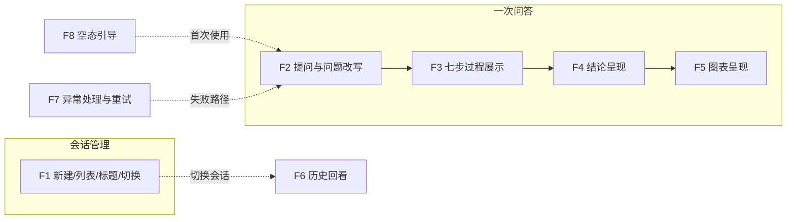

# chinook-chatbi 功能设计文档

> 版本：v0.1.1（功能设计）｜日期：2026-10-21 首发，2026-10-22 修订 E1 断开语义
>
> **文档边界**：本文档承接《chinook-chatbi 项目设计文档》v0.1（总体设计），回答"**应该有哪些功能、各功能的行为是什么**"。架构、技术栈、数据库设计（DDL）、API 字段级契约（REST/SSE/progress 消息结构/chart spec 字段）、Prompt 设计、各功能实现步骤，均由后续《技术设计文档》承接。
>
> 术语约定：**问题改写**指编排层的指代消解改写（把含指代的问句改写为自包含问题）；**SQL 改写**指七步链路第 ⑤ 步（校验失败后重写 SQL）。两者不同，本文严格区分。

---

## 1. 功能总览

| 编号 | 功能 | 一句话描述 | 主要决策 |
|---|---|---|---|
| F1 | 会话管理 | 新建（首条消息触发）、列表（LLM 短标题）、切换 | B1/B2/B3 |
| F2 | 提问与问题改写 | 多轮提问、指代消解改写（对用户可见、可降级） | C1/C2/E4 |
| F3 | 七步过程实时展示 | 步骤条跟随后端真实进度逐步点亮，SQL 即时可见 | C3/C4/C5 |
| F4 | 分析结论呈现 | markdown 渲染、打字机逐字播放 | C6 |
| F5 | 图表呈现 | bar/line/pie 三类、LLM 选型、悬停交互 | C7/E3 |
| F6 | 历史回看 | 会话回放：结论、图表、七步过程完整重放 | D1 |
| F7 | 异常处理与重试 | 失败落库、可读错误、重试即新一轮 | E1/E2 |
| F8 | 空态引导 | 欢迎语 + 可点击示例问题 | F1 |

---

## 2. F1 会话管理

### 2.1 新建会话

- 点击"新建会话"按钮：前端立即切换到空白对话视图，**不产生服务端请求**；
- 服务端会话在**首条消息发出时创建**：首轮请求不携带会话标识，服务端建会话后随第一个流式事件把会话标识发回前端，前端此后所有轮次携带它；
- 不会出现"从未提问的空会话"。

### 2.2 会话列表与标题

- 左侧会话栏常驻会话列表，按**最近活跃倒序**排列（默认项 #36）；
- 会话在首条消息发出后即出现在列表中，标题先以**首轮问题前 12 字**占位（与降级策略一致的推演行为，默认项 #41）；
- **首轮回答完成后**，由 LLM 生成 **≤12 字**短标题（如"2013 各国销售额"）并替换占位标题，列表即时更新；生成失败则保持截断占位，不重试、不阻断；
- 本期会话操作仅：新建、切换、回看；**无重命名、无删除**（总体设计 §1.2 既定）。

### 2.3 切换会话

- 点击列表中任一会话即切换，**随时可切，不受其他会话是否有轮次进行中影响**；
- 切换后主区加载该会话已落库的全部内容（见 F6）；
- 若被切离的会话仍有轮次在进行中：该轮**在后台继续执行并照常落库**；切回时若已完成则直接呈现结果，若仍在进行则该轮显示"分析进行中"占位，结果产生后自动出现（默认项 #39；机制已定为 SSE 重订阅，见技术设计 §7.2）。

---

## 3. 一次问答的功能行为（F2–F5）

### 3.1 F2 提问与问题改写

**输入约束（E4）**：

- 空消息不发送（发送按钮无效）；
- 输入超过 **500 字**时前端提示并禁止发送。

**问题改写（指代消解，C1/C2）**：

- 每轮用户提问后，系统先将其改写为**自包含问题**（如"那再按年份拆一下呢"→"2013 年销售额前 5 的国家，按年份拆分"），再送去分析；
- 改写结果以**灰字小字实时显示**在助手消息顶部："理解为：…"——多轮演示时改写效果看得见，回看时同样显示；
- 改写结果与原文一致时（首轮通常如此）**不显示**该小字（默认项 #40）；
- 改写调用失败：**重试一次 → 仍失败则降级直接使用用户原话**继续分析，不中断对话；顶部小字提示"改写失败，已使用原问题"。

### 3.2 F3 七步过程实时展示

**透传机制（C3）**：步骤条**跟随后端真实进度实时点亮**——MCP 分析工具执行过程中经 progress 通知逐帧外发步骤事件，业务 Server 转成 SSE 透传前端；分析工具保持粗粒度单入口（总体设计决策 #5 不变），"实时透明"（决策 #14）与"粗粒度"（决策 #5）兼得。

**步骤条形态（C5）**：

- 助手消息内**常驻固定 7 步**：`解析 → 选表 → 生成 → 校验 → 改写 → 执行 → 汇总`；
- 当前步高亮 + 动态指示；完成步打勾；失败步标红；
- 第 ① 步"解析"**瞬时点亮**（库结构已在服务启动时缓存，默认项 #38）；
- 校验失败 → SQL 改写重试循环：改写步再次点亮时，步骤区显示**"第 N 次尝试"**标记（重试上限 3 次，超限整轮失败，见 F7）；
- 全部完成后步骤条**折叠为一行摘要**"七步分析完成"，点击展开查看：各步摘要、最终 SQL、每次尝试的 SQL 与校验错误。

**每步推送的内容丰度（C4）**：名称 + 状态 + 一句话摘要；其中 **SQL 全文在第 ③ 步完成时即推送显示**，不必等整轮结束。各步摘要示例：

| 步骤 | 摘要示例 |
|---|---|
| ② 选表 | "选中 3 表：invoices、invoice_items、customers" |
| ③ 生成 | 显示 SQL 全文 |
| ④ 校验 | "通过" / "失败：仅允许单条 SELECT（第 1 次）" |
| ⑤ SQL 改写 | "第 2 次尝试" |
| ⑥ 执行 | "返回 42 行" / "返回 200 行（已截断，见结论说明）" |
| ⑦ 汇总 | "完成" |

### 3.3 F4 分析结论呈现

- 七步完成后，文字结论以**打字机效果逐字播放**（播放的是已生成的全文，观感即总体设计 §5 所述"文字增量"）；播放完毕本轮结束、解锁输入；
- 结论按 **markdown 渲染**（列表、加粗、简单表格），回看时同样渲染；
- 单值答案（如"共有多少客户"）：仅文字结论呈现数值，**不配图表**。

### 3.4 F5 图表呈现

- 图表卡片显示在结论下方；
- 图表类型 **bar / line / pie 三类**，由汇总步 LLM 根据数据形态**自动选型**；用户不可手动换型（列演进方向）；
- 交互采用 ECharts 自带能力：**悬停 tooltip、legend 显隐、饼图扇区选中**；不做下钻（总体设计 §9 演进方向）；
- 无合适图表时不显示卡片（与 3.3 单值情形衔接）。

**截断提示（E3）**：查询结果超过 200 行被强制截断时，第 ⑥ 步摘要注明行数与截断状态，且结论尾部固定附系统提示："**结果超过 200 行，已展示前 200 行**"——数据边界对用户透明。

---

## 4. F6 历史回看

切换会话（或刷新页面重新进入）时，加载该会话已落库的全部消息并**完整还原**：

- 用户消息：显示**原文**；
- 助手消息按实时问答完成态还原：
  - 顶部"理解为：…"小字（若该轮发生过改写）；
  - 结论**整段直接显示**（不再打字机重放），markdown 渲染（默认项 #35）；
  - 步骤条呈**折叠态**，点击可展开查看七步过程、最终 SQL 与重试详情——**过程重放与实时体验一致**（D1）；
  - 图表卡片按落库的图表数据**本地重渲染**，交互能力不变；
  - 失败轮次还原为失败气泡（含当时的可读错误与已尝试 SQL，可展开）。

---

## 5. F7 异常处理与重试

### 5.1 失败的情形与展示

以下情形均按**失败轮**处理：改写重试超限（SQL 校验连续 3 次不通过）、分析服务超时或不可达、LLM 结构化输出解析重试后仍失败。

**SSE 流中途断开不视为失败**（E1，v0.1.1 修订）：分析在服务端后台继续执行并照常落库；用户切回该会话或刷新页面后，通过重订阅续看进行中轮次，或直接回看已完成结果。仅当业务 Server 重启时，遗留的进行中轮次才被标记为失败（见技术设计 §7.2、决策 #47）。

失败轮行为：

- 前端显示**失败气泡**：可读的错误说明 + "重试"按钮；
- 已尝试的 SQL 与错误清单**可展开查看**（用户可读、可截图反馈，总体设计 §4.2）；
- 失败消息**照常落库**（含错误状态），回看时可见。

### 5.2 重试语义

- 点击"重试" = **以原问题重新发起一轮新的请求**，追加到会话末尾；**不替换、不删除**失败消息——历史完整，无需消息更新类接口。

### 5.3 输入锁定（E2）

- 一轮进行中（发送 → 打字机播放完毕）：**当前会话输入框禁用**；
- **切换其他会话不受影响**，被切离会话的进行中轮次后台跑完落库（见 2.3）；
- 本期无"停止生成"按钮（列演进方向）。

### 5.4 只读拒绝（危险请求）

用户提出写操作类请求（如"删除所有客户"）：链路在生成/校验步被只读防线拦截，走 5.1 失败路径，错误信息明确说明"**仅支持只读查询**"。用户可见行为与其它失败一致，无特殊分支。

---

## 6. F8 空态引导

首次打开（无任何会话）时，主对话区居中显示：

- 简短欢迎语（说明"用自然语言问 chinook 音乐销售数据"）；
- **3–4 个可点击示例问题**，点击即填入输入框，例如（已对照真实表域）：
  - "2013 年销售额最高的 5 个国家是哪些？"
  - "每种音乐流派各有多少首曲目？"
  - "累计消费金额最高的客户是谁？"
  - "销售额逐年趋势如何？"

---

## 7. 界面功能布局（区块级）

| 区块 | 承担功能 |
|---|---|
| 左侧会话栏 | F1：新建按钮、会话列表（倒序、短标题） |
| 主区对话流 | F2–F6：消息气泡（含改写小字、七步步骤条、结论、图表卡片）、空态时居中显示 F8 |
| 底部输入区 | F2：多行输入 + 发送；超 500 字禁发提示；本轮进行中禁用（F7） |

视觉稿与组件细节不在本文范围。

---

## 8. 数据与运行形态边界

- **数据域**：chinook（11 张业务表、11 条外键）；库文件**复制一份进本项目自包含**（决策 F2），不依赖课件或作业一路径；
- **只读与限量**：严格只读（用户可见影响见 5.4）、结果上限 200 行（用户可见影响见 3.4 截断提示）；
- **运行形态**：本机三进程演示（前端 / 业务 Server / MCP Server），与总体设计 §8 一致。

---

## 9. 移交《技术设计文档》的事项

| # | 事项 | 缘起 |
|---|---|---|
| 1 | REST / SSE 字段级契约（含 step/answer/chart/error/done 各事件 payload） | 本文只定行为与事件语义 |
| 2 | progress 通知的 JSON 结构及其到 SSE step 事件的映射 | 决策 C3/C4 的实现载体 |
| 3 | chart spec 字段级定义（类型/轴/聚合/数据行） | 总体设计 §5 已有要点 |
| 4 | SQLite DDL（messages 需补 steps_trace、状态列；sessions 补标题占位逻辑相关字段） | 决策 D1/E1 |
| 5 | Prompt 设计：问题改写、选表、SQL 生成、汇总（结论 + 图表选型）、标题生成 | 本文定各步行为 |
| 6 | mcp 2.x 适配：`mcp.server.fastmcp` 已删除、改名 MCPServer（事实核查结论） | 实现前置坑 |
| 7 | 切回"进行中会话"的刷新机制（轮询或推送） | 默认项 #39 |
| 8 | 超时与并发参数（MCP 调用、LLM 调用、SSE 连接） | 总体设计 §4.2 细化 |

---

## 附录：功能设计决策记录（续总体设计 #1–16）

| # | 决策项 | 结论 | 关键理由 |
|---|---|---|---|
| 17 | 文档分工 | 功能文档=有哪些功能+行为；技术文档=实现（架构/技术栈/DB/API/实现步骤） | 两份文档各自完整、不重复 |
| 18 | 会话创建时机 | 首条消息触发建，会话标识随首个流式事件返回 | 少一次交互，不堆积空会话 |
| 19 | 会话标题 | 首轮回答完成后 LLM 生成 ≤12 字，失败降级截断 | 列表可读性，一次轻量调用 |
| 20 | 改写可见性 | "理解为：…"小字实时显示，回看同显 | 指代消解是设计亮点，应可见 |
| 21 | 改写降级 | 重试一次→降级用原文继续，不阻断 | 与总体设计 §4.2 重试哲学一致 |
| 22 | 七步透传机制 | progress 通知真实时推送，步骤条跟随真实进度 | SDK 已核实支持；#5 与 #14 兼得 |
| 23 | 步骤事件丰度 | 名称+状态+摘要；SQL 生成步完成即推送全文 | 过程可看性最强，流量小 |
| 24 | 步骤条形态 | 固定 7 步逐步点亮；重试显次数；完成后折叠可展开 | 链路全景 + 不占版面 |
| 25 | 结论呈现 | markdown 渲染 + 前端打字机 | 表达力 + 收尾观感，零协议改动 |
| 26 | 图表能力 | bar/line/pie、LLM 选型、ECharts 交互；单值不画图 | 边界克制，选型叙事一致 |
| 27 | 过程回放 | steps_trace 入库，回看完整重放 | 实时与回看体验一致 |
| 28 | 失败与重试 | 失败落库；重试=追加新一轮；SSE 中断**不视为失败**（后台跑完落库、重连续看，v0.1.1 随技术设计修订；原为"视为失败"） | 历史完整，免消息更新接口；状态以库为准 |
| 29 | 输入锁定 | 本会话禁用、切换自由、后台跑完落库 | 防并发不牺牲灵活 |
| 30 | 截断提示 | 明确提示"已展示前 200 行" | 数据边界透明 |
| 31 | 输入约束 | 空不发；超 500 字禁发 | 防误触与超长 prompt |
| 32 | 空态引导 | 欢迎语+可点击示例 | 演示友好，示例即功能素材 |
| 33 | 库文件来源 | chinook.db 复制进项目自包含 | 换机可跑，不依赖外部路径 |
| 34 | 结论渲染 | markdown（列表/加粗/表格） | LLM 天然输出，可读性 |

**默认项**（起草中按推演落定，可调整）：

| # | 默认项 | 内容 |
|---|---|---|
| 35 | 回看呈现 | 结论整段直接显示（不重放打字机），步骤条折叠态 |
| 36 | 会话列表排序 | 按最近活跃倒序 |
| 37 | get_schema 工具 | 无前端入口，仅诊断/演示用 |
| 38 | 解析步展示 | 第 ① 步瞬时点亮（启动已缓存） |
| 39 | 切回进行中会话 | 显示"分析进行中"占位，结果产生后自动出现 |
| 40 | 改写小字显示条件 | 改写结果与原文一致时不显示 |
| 41 | 标题占位 | 首轮进行中以前 12 字占位，回答完成后替换 |
