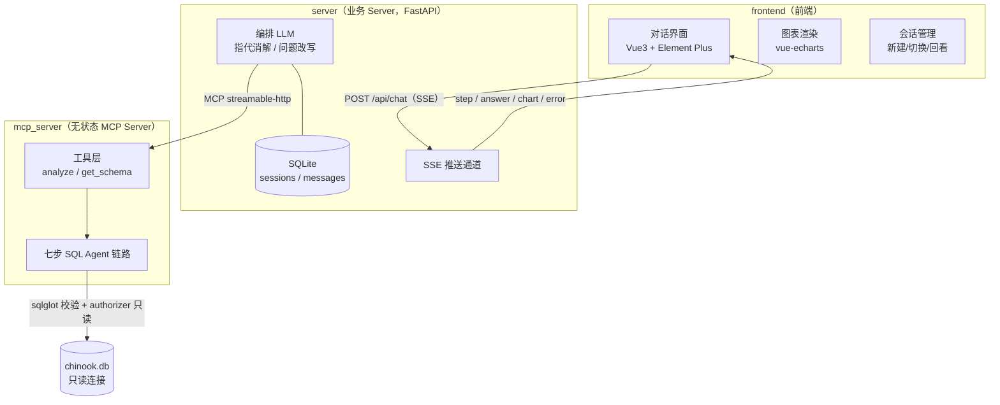
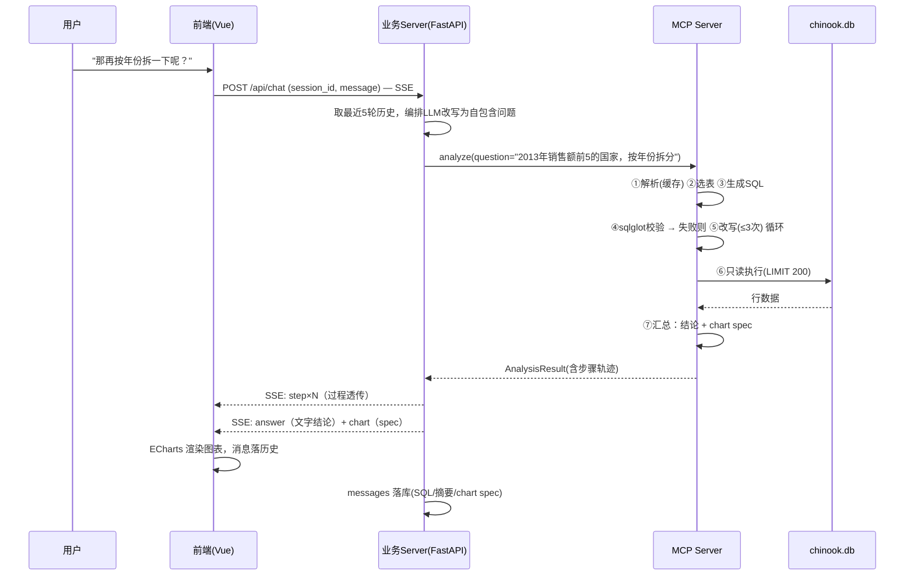

# chinook-chatbi 项目设计文档

> 版本：v0.1（总体设计）｜日期：2026-10-21
>
> **文档边界**：本文档为总体设计（概要设计），覆盖背景、架构、模块划分、关键流程、接口与存储要点、安全与部署。字段级表结构、完整接口签名、Prompt 设计等细节由后续的《功能设计文档》《技术设计文档》承接。

---

## 1. 背景与目标

### 1.1 背景

传统 BI 工具功能强大但操作复杂，需要专业人员通过图表配置与公式编写获取洞察，无法用自然语言直接问数。ChatBI（对话式商业智能）让用户以自然语言提问，由 LLM 驱动的 SQL Agent 自动完成取数、分析与可视化，是 LLM 应用落地的典型场景。

本项目为 week11 作业二，与作业一（SQL Agent workflow）形成连续性：作业一要求参考课件 `sql-agent.ipynb` 实现完整七步链路（仓库中尚未提交代码）；课件 notebook 本身只提供了数据库解析（`DBParser`）与 LLM 调用封装，其定位是离线问答对合成流水线。本项目在 MCP Server 内完整实现七步链路并将其产品化为 ChatBI 应用，同时参考课件《05-项目案例-ChatBI股票助手》的分布式思路——SQL 分析能力以 MCP 服务形式独立部署，而非嵌入前端应用。

### 1.2 目标

1. 用户以自然语言提问（支持多轮对话与指代消解），自动生成 SQL 并返回文字结论 + 交互式图表；
2. SQL 分析能力封装为**无状态 MCP Server**，通过 streamable-http 暴露，业务层以协议解耦，可本地运行也可迁移云端；
3. 完整实现七步 SQL Agent 链路（解析→选表→生成→校验→改写→执行→汇总），过程状态实时透传前端，链路透明可观测；
4. 会话与历史持久化，支持多会话新建、切换与回看。

### 1.3 非目标（本期不做）

- 多用户与鉴权（单用户演示）
- 写操作（严格只读）
- chinook 以外的数据源适配（架构上预留演进空间）

---

## 2. 总体架构

### 2.1 架构图



### 2.2 分层职责

| 层 | 进程 | 职责 | 不做什么 |
|---|---|---|---|
| 前端 | `frontend/`（Vite dev / 静态构建产物） | 对话交互、七步进度展示、chart spec 渲染、会话管理 | 不直接接触数据库、不编排 SQL 链路 |
| 业务 Server | `server/`（FastAPI + uvicorn） | 对话编排（指代消解）、历史持久化、SSE 透传、MCP 客户端 | 不解析 schema、不生成/执行 SQL |
| MCP Server | `mcp_server/`（mcp SDK，streamable-http） | 七步 SQL Agent 链路、只读安全防线、chart spec 产出 | 不保存对话历史（无状态）、不关心用户会话 |

**关键解耦**：MCP Server 无状态、不认识"会话"，只接收自包含的分析问题；对话上下文全部收敛在业务 Server。这使 MCP Server 可独立测试、可被多个前端复用、可单独部署云端。

---

## 3. 模块设计

### 3.1 前端（frontend/）

- **技术栈**：Vue 3 + Vite + Element Plus + vue-echarts（ECharts）
- **核心界面区**：
  - 左侧会话栏：会话列表、新建、切换（回看历史消息与图表）
  - 主区对话流：用户/助手消息气泡；助手消息内嵌**七步进度条**（实时显示"正在选表 → 生成 SQL → 校验 → 改写 → 执行 → 汇总"）与最终图表
- **与后端交互**：`POST /api/chat` 建立 SSE 连接，按事件类型增量渲染；图表按 chart spec 本地渲染（缩放/悬停等交互由 ECharts 提供）

### 3.2 业务 Server（server/）

- **技术栈**：FastAPI + uvicorn + sse-starlette + openai（OpenAI 兼容接口，模型取自 `.env` 的 `BASE_MODEL`）
- **编排 LLM**：维护对话状态的"大脑"。每轮用户输入，携最近 5 轮历史，将可能含指代的问句（如"那再按年份拆一下呢"）改写为**自包含问题**，再调用 MCP 工具 `analyze(question)`
- **历史持久化**：SQLite 双表（见 §6），每轮落库问题、改写后问题、生成的 SQL、结果摘要、chart spec
- **SSE 透传**：消费 MCP 调用返回的步骤轨迹（steps trace），以 `step` 事件实时推送前端；最终 `answer` + `chart` 事件收尾

### 3.3 MCP Server（mcp_server/）

- **技术栈**：官方 mcp SDK（2.1.1）+ sqlglot + pandas，streamable-http transport
- **对外工具**（粗粒度、接口小而深）：

| 工具 | 签名要点 | 说明 |
|---|---|---|
| `analyze` | `analyze(question: str) -> AnalysisResult` | 内部执行完整七步链路；返回 SQL、列、行数据（≤200）、文字汇总、chart spec、步骤轨迹 |
| `get_schema` | `get_schema() -> SchemaSummary` | 返回表清单与外键关系摘要（诊断/演示用） |

- **七步链路**：

| # | 步骤 | 输入 → 输出 | 实现要点 |
|---|---|---|---|
| 1 | 数据库解析 | chinook.db → schema 缓存 | 启动时解析表结构/外键/采样（参考课件基于 SQLAlchemy 的 `DBParser`：`get_table_fields` / `get_data_relations` / `get_table_sample`），进程内缓存 |
| 2 | 选表 | 自包含问题 → 相关表集合 | 两段式：LLM 先看全库表关系摘要（11 张业务表 + 外键），输出相关表与 join 路径；chinook 核心分析表如 invoices / invoice_items / customers / tracks / artists / genres |
| 3 | SQL 生成 | 问题 + 选中表详细字段 → SQL | 仅注入选中表的字段级 schema，生成单条 SELECT |
| 4 | SQL 校验 | SQL → 通过/错误详情 | **sqlglot AST 级**：仅允许单条 SELECT；拒绝 DML/DDL/PRAGMA/ATTACH、多语句、非只读函数；给出错误位置与原因（供改写回喂） |
| 5 | SQL 改写 | SQL + 错误信息 → 新 SQL | 失败重试上限 **3 次**；超限则终止并返回已尝试的 SQL 与错误清单 |
| 6 | SQL 执行 | SQL → 行数据 | 连接以只读模式打开 + `sqlite3.set_authorizer` 内核级只读白名单兜底；结果自动注入 `LIMIT 200` |
| 7 | 结果汇总 | 行数据 → 结论 + chart spec | LLM 产出文字结论与结构化 chart spec（图表类型/X/Y 轴/聚合方式），一次输出双产物 |

> 对比课件：demo 的 `check_sql` 以"真执行一遍"做校验，无任何只读防护；本项目以 AST 白名单 + 内核级 authorizer 构成实质升级（见 §7）。

---

## 4. 关键流程

### 4.1 一次多轮提问的完整时序（第二轮，含指代）



### 4.2 失败与降级

- 校验失败：步骤 ④→⑤ 循环，最多 3 次；超限返回 `error` 事件，附全部已尝试 SQL 与错误，用户可读、可截图反馈；
- MCP 调用超时/不可达：SSE 推送 `error` 事件提示服务状态，前端展示重试入口；
- LLM 输出非法 JSON（选表/生成/汇总步）：解析失败即以原始错误重试一次，仍失败走降级报错。

---

## 5. 接口要点（细节留给技术设计文档）

**REST（前端 ↔ 业务 Server）**

| 接口 | 方法 | 说明 |
|---|---|---|
| `/api/chat` | POST | `{session_id, message}` → SSE 流（事件见下） |
| `/api/sessions` | GET/POST | 会话列表 / 新建会话 |
| `/api/sessions/{id}/messages` | GET | 回放历史消息（含图表 spec） |

**SSE 事件类型**：`step`（步骤名+状态）、`answer`（文字增量）、`chart`（chart spec）、`error`（可读错误）、`done`（收尾）。

**chart spec 要点**（汇总步产出、前端渲染的契约）：

```json
{
  "type": "bar | line | pie",
  "title": "2013年销售额前5国家（按年份）",
  "x": { "field": "year", "label": "年份" },
  "y": [{ "field": "total", "label": "销售额", "agg": "SUM" }],
  "rows": [ /* ≤200 行，随 spec 一体返回 */ ]
}
```

**MCP 工具返回**（`AnalysisResult` 要点）：`sql`、`steps_trace[]`、`columns[]`、`rows[][]`（≤200）、`summary`、`chart_spec`。

---

## 6. 存储设计要点

业务 Server 侧 SQLite（如 `server/data/chatbi.db`），双表：

```sql
-- 要点级草案，字段细节由技术设计文档定稿
CREATE TABLE sessions (
  id          TEXT PRIMARY KEY,      -- 会话ID
  title       TEXT,                  -- 首轮问题摘要
  created_at  TIMESTAMP,
  updated_at  TIMESTAMP
);

CREATE TABLE messages (
  id           INTEGER PRIMARY KEY AUTOINCREMENT,
  session_id   TEXT REFERENCES sessions(id),
  role         TEXT,                 -- user / assistant
  content      TEXT,                 -- 原始问题 / 汇总结论
  question_rw  TEXT,                 -- 改写后的自包含问题（user 行）
  sql_text     TEXT,                 -- 最终执行的 SQL（assistant 行）
  chart_spec   TEXT,                 -- JSON，可空
  created_at   TIMESTAMP
);
```

---

## 7. 安全与容错

**只读三层防线**（纵深防御，任一层独立成立）：

1. **AST 白名单**（sqlglot）：仅接受单条 SELECT；拒绝 INSERT/UPDATE/DELETE/DROP/PRAGMA/ATTACH、多语句、写函数（如 `writefile`）；
2. **内核级拦截**（`sqlite3.set_authorizer`）：即使 SQL 逃过第 1 层，连接层仅放行 SELECT 读动作；
3. **连接与限流**：SQLite 以只读模式（`mode=ro`）打开；结果强制 `LIMIT 200`，防止全表拖库与超长上下文。

**LLM 稳定性**：结构化输出解析失败自动重试；改写循环有硬上限；所有错误对用户可读。

---

## 8. 部署方案

**本机多进程演示**（作业交付形态）：

```bash
# 1. MCP Server（默认 http://localhost:8001，streamable-http）
uvicorn mcp_server.app:app --port 8001

# 2. 业务 Server（默认 http://localhost:8000，SSE）
uvicorn server.app:app --port 8000

# 3. 前端
cd frontend && npm run dev   # Vite 默认 5173
```

**迁向远程**：MCP Server 在云主机以同一命令启动（换 `--host 0.0.0.0`），业务 Server 通过环境变量 `MCP_URL` 指向远程地址即可，代码零改动——这是"分布式部署、本地不跑 agent"目标的直接兑现。

**环境**：conda `py312`（fastapi 0.140 / uvicorn 0.40 / sse-starlette 3.4.10 / mcp 2.1.1 / openai 2.50 / pandas 3.0 均已就绪；**sqlglot 需补装**）；LLM 凭据沿用项目根 `.env`（`API_KEY` / `BASE_URL` / `BASE_MODEL`）。

---

## 9. 演进方向

1. 多用户与鉴权（业务 Server 加会话/token 层）
2. 选表升级为 schema 向量检索 + LLM 混合，支撑更大规模库
3. 查询结果缓存与 FAQ 热点问答
4. 数据源适配层（MySQL/PostgreSQL/DuckDB），MCP 工具签名不变
5. 图表联动下钻（点击图表生成追问）

---

## 附录：设计决策记录

| # | 决策项 | 结论 | 关键理由 |
|---|---|---|---|
| 1 | 交付物 | 本期只出总体设计文档 | 功能/技术设计文档后续专项讨论 |
| 2 | 架构形态 | 三层：前端 / 业务 Server / MCP Server | 对话状态与分析能力解耦，贴合课件 05 分布式思路 |
| 3 | 数据领域 | chinook.db（音乐销售，11 张业务表） | 与作业一衔接、自包含无外部依赖 |
| 4 | SQL 链路 | 完整七步在 MCP Server 内实现 | 链路完整是作业核心考察点 |
| 5 | MCP 粒度 | 粗粒度 analyze + get_schema | 接口小而深，协议流量小 |
| 6 | MCP 传输 | streamable-http | 真分布式形态，本地/远程同一套代码 |
| 7 | 历史存储 | 业务 Server 侧 SQLite 双表多会话 | MCP Server 保持无状态 |
| 8 | 图表决策 | 汇总步产出 chart spec | 链路一体化，汇总步有明确产物 |
| 9 | 指代消解 | 业务 Server 编排 LLM 改写（携最近 5 轮） | server 无状态、可独立测试 |
| 10 | 只读安全 | sqlglot AST + authorizer + 只读连接 + LIMIT 200 | 纵深防御，对课件无防护的升级 |
| 11 | 部署 | 本机多进程演示，文档含远程迁移方案 | 无基础设施依赖 |
| 12 | 前端 | Vue3 + Vite + Element Plus + ECharts | 工程化前端，生态统一 |
| 13 | 业务框架 | FastAPI（SSE 原生支持） | 与异步/SSE 需求匹配 |
| 14 | 交互 | SSE 流式 + 七步过程透传 | 过程透明是 ChatBI 最大展示亮点 |
| 15 | 选表策略 | 两段式 LLM 选表（先摘要选表，后详参生成） | 省 token，选表独立可展示 |
| 16 | 命名 | chinook-chatbi | — |
