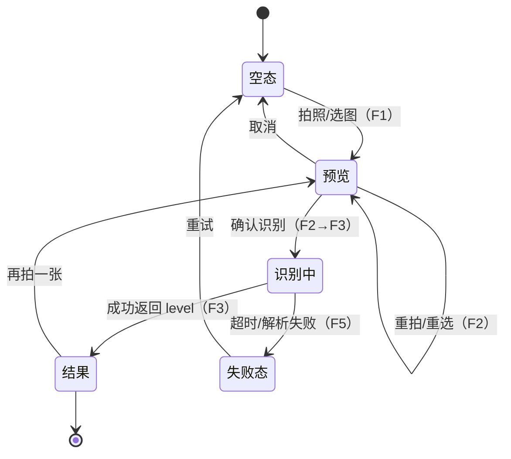

# 楼道消防隐患识别应用 PRD

> 版本：v0.1｜日期：2026-10-28
>
> **文档边界**：本文档回答"做什么、做到什么程度算对"——用户场景、功能行为、接口约定、验收标准。组件结构、部署脚本等实现细节由开发过程自行沉淀，不在本文展开。
>
> 需求来源：`readme.md`（作业要求）＋ 课程参考案例「多模态内容理解」（课件 notebook 不随仓库分发）。决策依据见 §10 决策记录（D1–D8 及细节默认项 S1–S10）。

---

## 1. 背景与目标

### 1.1 问题背景

楼道堆物、电动车进楼是居民楼火灾的高发诱因。人工巡检需要逐层查看、主观判断，效率低且标准不一。本应用让巡检人员（或居民）用手机对楼道拍照，由多模态大模型实时判断照片中场景的消防安全隐患等级。

### 1.2 方案思路

课程参考案例对比了四种技术路线：

| 路线 | 开发成本 | 推理成本 | 备注 |
|---|---|---|---|
| ResNet 图像分类 | 需标注数据训练 | 低 | 类别固定，泛化差 |
| YOLO 目标检测 | 标注＋训练约 5 天 | 很低 | 需专门采集标注 |
| Chinese-CLIP 打标 | 免训练 | 低 | 只能粗粒度相似度 |
| **Qwen-VL 图文问答** | **约 2 小时** | 云端 API 按量计费 | **本应用采用** |

本应用将案例中本地部署 Qwen2.5-VL（需 24GB GPU）的推理，替换为云端多模态 API 调用（`qwen3.8-max`，OpenAI 兼容接口，**2026-10-28 已实测接受 base64 图片输入并正确识图**），并产品化为前后端 Web 应用。

### 1.3 目标

浏览器打开网页 → 拍照或选择图片 → 上传 → 展示风险分级结果（五级之一）。

### 1.4 边界外（本期明确不做）

- 识别历史记录与持久化存储
- 识别理由/置信度展示（仅后端日志留档，见 S3）
- 多模型对比识别
- 用户系统、权限、多人协作
- 正式 HTTPS 证书（演示场景用降级方案替代，见 F4）

## 2. 分类标准与术语

### 2.1 风险等级标准枚举（D6）

| level 码 | 中文标签 | 判定定义 | UI 颜色（Element Plus 色板） |
|---|---|---|---|
| `high` | 高风险 | 楼道中出现电动车、电瓶、飞线充电等可能起火的元素 | 危险红 `#F56C6C` |
| `medium` | 中风险 | 大量堆积物严重影响通行，或堆放大量纸箱、木质家具等能造成火势蔓延的堵塞物 | 警告橙 `#E6A23C` |
| `low` | 低风险 | 存在楼道堆物现象但不严重 | 淡黄 `#F7D75B`（或 warn 色浅化） |
| `none` | 无风险 | 楼道干净，无堆放物品 | 成功绿 `#67C23A` |
| `not_corridor` | 非楼道 | 与楼道无关的图片 | 中性灰 `#909399` |

**归一化映射**：模型输出可能使用需求原文的变体词，后端按此归一化后再返回——`无隐患→none`、`中等风险→medium`、`无堆物/干净→none` 等同义变体统一映射到上表五值；无法映射的输出走解析失败路径（F5）。

### 2.2 术语

- **识别**：一次"上传图片 → 模型判定 → 返回 level"的完整链路。
- **拍照**：浏览器 `getUserMedia` 调起摄像头实时取流并截帧。
- **相册上传**：文件选择器选取本地图片。
- **降级**：摄像头不可用时隐藏拍照入口、仅保留相册上传（见 F4）。

## 3. 用户与使用场景

| 场景 | 终端 | 入口 | 图片来源 | 说明 |
|---|---|---|---|---|
| A 桌面演示/开发 | 电脑浏览器 | `http://localhost:5173` | 摄像头拍照 ＋ 相册上传 | localhost 下 `getUserMedia` 可用，全功能 |
| B 手机真机演示 | 手机浏览器（与电脑同一 WiFi） | `http://<电脑局域网IP>:5173` | 相册上传为主；若浏览器允许摄像头则同 A | 局域网 HTTP 下多数手机浏览器拦截 `getUserMedia`，自动降级（F4） |

双通道均为验收范围（D4、D8）。

## 4. 功能总览

| 编号 | 功能 | 一句话描述 | 主要决策 |
|---|---|---|---|
| F1 | 图片获取 | 摄像头拍照 / 相册选图，前端压缩 | D7、S4 |
| F2 | 预览与确认 | 两步交互：预览 → 确认识别 / 重拍重选 | D7 |
| F3 | 识别与结果展示 | 上传 → loading → 五级结果大标签 | D3、S1、S2 |
| F4 | 摄像头降级 | 探测摄像头不可用 → 隐藏拍照入口 | D4、S8 |
| F5 | 异常处理 | 文件校验、模型超时、解析失败的可读提示与重试 | D8、S5、S6、S7 |



## 5. 功能行为详述

### 5.1 F1 图片获取

- **拍照**：进入页面即探测 `getUserMedia`；可用则展示"拍照"入口，调起视频流，全屏或内嵌取景框，按钮截帧为图片；
- **相册上传**：`accept="image/*"` 的文件选择，桌面端等同"上传图片"；
- 两个入口产出统一的图片对象，进入 F2 预览；
- **前端压缩（S4）**：截帧/选图后经 canvas 压缩——长边 ≤1280px、JPEG 质量 0.8，再进入预览与上传（压缩后典型 ≤500KB，保证手机网络上传与模型处理速度）。

### 5.2 F2 预览与确认（两步交互）

- 预览页展示待识别图片，提供两个操作：**重拍/重选**（回到 F1）、**确认识别**（进入 F3）；
- 预览阶段允许**取消**返回空态；
- 设计动机：手机拍照虚焦、构图偏差常见，预览拦截废片，提高识别成功率（D7）。

### 5.3 F3 识别与结果展示

- 点击"确认识别"后图片以 multipart 上传至 `POST /api/recognize`（§6），前端进入 loading 态（按钮禁用＋进度提示，不提供取消）；
- 返回后展示**结果大标签**：颜色色块（§2.1 色板）＋ 中文标签 ＋ 该等级的一句话判定标准（如高风险展示"出现电动车、电瓶、飞线充电等可能起火的元素"）；
- `not_corridor` 时额外提示文案（S9）："该图片不是楼道场景，请拍摄楼道照片"，并引导重拍；
- 结果页提供"再拍一张"回到 F1；
- 模型原始文本输出**不在前端展示**，仅后端日志留档（S3）。

### 5.4 F4 摄像头降级

- 页面加载时探测 `navigator.mediaDevices.getUserMedia` 可用性（含 HTTP 非安全上下文判断）；
- 不可用（典型：手机浏览器经局域网 HTTP 访问）→ **自动隐藏"拍照"入口**，仅保留"相册上传"，页面给出一句说明（"当前环境不支持摄像头，可通过相册选择照片"）；
- 可用 → 两入口并存；
- 不做 HTTPS 自签证书方案（§1.4），降级即最终方案（S8）。

### 5.5 F5 异常处理

| 情形 | 后端行为 | 前端表现 |
|---|---|---|
| 非图片文件 / 超过 10MB（S5） | 400 拒绝，错误码 `INVALID_FILE` | "仅支持 jpg/png/webp 图片，且不超过 10MB" |
| 模型调用超时（>30s，S7） | 终止等待，504 `MODEL_TIMEOUT` | "识别超时，请重试" |
| 模型返回无法解析（重试 1 次仍失败，S6） | 502 `MODEL_UNPARSABLE` | "识别失败，请重试或换一张照片" |
| 网络断开 / 服务不可达 | —（前端捕获） | "网络异常，请检查连接后重试" |

所有失败态均提供"重试"（重新上传同一张压缩图）与"重新选择"两个出口；失败不清空已选图片。

## 6. 接口约定

### 6.1 识别接口

```
POST /api/recognize
Content-Type: multipart/form-data

字段：image = <图片文件，jpg/png/webp，≤10MB>
```

**成功响应** `200`：

```json
{ "level": "high" }
```

`level` 取值：`high | medium | low | none | not_corridor`（§2.1）。

**失败响应**：`400 INVALID_FILE` / `504 MODEL_TIMEOUT` / `502 MODEL_UNPARSABLE`，body 统一 `{ "error": { "code": "...", "message": "人类可读中文" } }`。

### 6.2 识别逻辑约定（后端）

1. 校验文件类型与大小（S5）；
2. 图片转 base64 data URL，以 OpenAI 兼容接口调用 `BASE_MODEL`（环境变量配置，当前为 `qwen3.8-max`，D2/S2）；
3. Prompt 基于课程案例五分类 prompt（附录 A），输出约定为五个枚举词之一；
4. 对模型输出做**归一化映射**（§2.1），映射成功即返回；
5. 无法映射 → 重试 1 次（S6）→ 仍失败返回 `MODEL_UNPARSABLE`；
6. 模型调用超时上限 30s（S7）；模型原始输出写入后端日志（S3），**图片不落盘、不存储**（S10）。

### 6.3 其他

- 后端开启 CORS 允许前端 dev 端口跨域访问；
- 仅此一个业务接口，无鉴权、无会话。

## 7. 非功能需求

| 项 | 要求 |
|---|---|
| 识别链路耗时 | 单次 ≤30s 硬上限（超时报错）；常态目标 ≤10s |
| 并发 | 单用户演示场景，不做并发要求 |
| 图片隐私 | 识别即弃，服务端不存储图片（S10） |
| 浏览器兼容 | 最新版 Chrome / Safari（含 iOS Safari） |
| 运行环境 | 后端 Python py312 conda 环境；凭据走项目根 `.env` |

## 8. 技术基线

| 层 | 选型（D5，沿用 week11 作业一栈） |
|---|---|
| 前端 | Vue 3 ＋ TypeScript ＋ Vite ＋ Element Plus |
| 后端 | Python FastAPI ＋ uvicorn ＋ openai SDK ＋ pydantic-settings |
| 模型 | `qwen3.8-max`（阿里云 MaaS，OpenAI 兼容接口；模型名走 `BASE_MODEL` 配置，D2） |

**已验证事实**：2026-10-28 实测 `qwen3.8-max` 接受 `data:image/png;base64` 格式图片输入并正确识图（OpenAI 兼容 `image_url` content 格式）。

端口约定：前端 Vite dev 默认 5173（`--host` 对局域网开放）；后端默认 8000，被占用时用 8001（见 `.env`/启动脚本约定）。

## 9. 验收标准（D8）

| # | 验收项 | 通过标准 |
|---|---|---|
| 1 | 五类分类正确性 | 高风险/中风险/低风险/无风险/非楼道各 ≥1 张测试图，全部返回正确 `level` |
| 2 | 桌面全链路 | localhost 打开 → 摄像头拍照 → 预览 → 确认 → 10s 内出结果 |
| 3 | 手机降级链路 | 手机局域网打开 → 拍照入口自动隐藏 → 相册选图 → 识别出结果 |
| 4 | 相册上传（桌面） | 文件选择器选图 → 走完同一链路 |
| 5 | 两步交互 | 预览页可重拍/重选/取消，确认后才上传 |
| 6 | 异常路径 | 非图片文件、超 10MB、模拟超时/解析失败，均返回表内可读提示，且可重试 |
| 7 | 非楼道引导 | 上传无关图片返回 `not_corridor`，前端展示引导文案 |

测试图自备（建议每类 2 张，覆盖典型场景：电动车、纸箱堆积、少量杂物、干净楼道、风景/人物照）。

## 10. 决策记录

### 10.1 根决策（访谈确认，2026-10-28）

| # | 决策 | 结论 |
|---|---|---|
| D1 | PRD 形态 | 单份完整 PRD，不拆多份（应用规模小） |
| D2 | 模型落地 | `qwen3.8-max` 为主，模型名走 `BASE_MODEL` 配置；不引入 ds flash 4.1（无凭据，`.env` 未配） |
| D3 | 功能范围 | 最小闭环（拍照/上传 → 识别 → 分级展示）；历史记录、理由展示、多模型对比均不做 |
| D4 | 部署形态 | 双通道：桌面 localhost ＋ 手机局域网（降级相册上传） |
| D5 | 技术栈 | 沿用 week11：Vue3+TS+Vite+Element Plus / FastAPI+uvicorn+openai |
| D6 | 标准枚举 | `高风险/中风险/低风险/无风险/非楼道`，与老师五分类列表一致 |
| D7 | 拍照交互 | 两步：拍照/选图 → 预览确认 → 上传识别 |
| D8 | 验收标准 | 五类全对 ＋ 双通道 ＋ 异常路径（§9） |

### 10.2 细节默认项（PRD 内定稿，审稿可改）

| # | 项 | 默认值 |
|---|---|---|
| S1 | 接口 | `POST /api/recognize`，multipart 上传，响应英文码 `level`，前端映射中文/颜色 |
| S2 | 模型配置 | 模型名不写死，读 `.env` 的 `BASE_MODEL` |
| S3 | 模型原始输出 | 后端日志留档，前端不展示 |
| S4 | 前端压缩 | canvas 长边 ≤1280px、JPEG 质量 0.8 |
| S5 | 文件约束 | jpg/png/webp、≤10MB |
| S6 | 解析失败 | 归一化失败重试 1 次，仍失败返回 `MODEL_UNPARSABLE` |
| S7 | 超时 | 模型调用 30s 上限 |
| S8 | 摄像头降级 | 不做 HTTPS 自签；`getUserMedia` 不可用即隐藏拍照入口 |
| S9 | 非楼道文案 | "该图片不是楼道场景，请拍摄楼道照片" |
| S10 | 图片存储 | 识别即弃，服务端不落盘 |

## 11. 交付物清单

| 交付物 | 说明 |
|---|---|
| 本 PRD | `邓帅/week12/作业一/PRD.md` |
| 前端源码 | `frontend/`（Vite 工程） |
| 后端源码 | `backend/`（FastAPI 工程） |
| 运行说明 | `readme.md` 更新：环境准备、启动命令、局域网访问方式、验收自查步骤 |

---

## 附录 A：识别 Prompt 基准（源自课程案例，可微调措辞，分类定义不得偏离 §2.1）

```text
你是一个专业消防专家，擅长识别各种风险。请帮我识别消防安全隐患以及隐患的危险程度。
根据楼道中是否存在大量堆积物，堆积物是否可燃以及是否有起火风险将隐患分为
高风险、中风险、低风险、无风险、非楼道。直接输出风险类别，不需要解释。

- 高风险：楼道中出现电动车、电瓶、飞线充电等可能起火的元素。
- 中风险：楼道中存在大量堆积物严重影响通行或堆放大量纸箱、木质家具等能造成火势蔓延的堵塞物。
- 低风险：存在楼道堆物现象但不严重。
- 无风险：楼道干净，无堆放物品。
- 非楼道：一些与楼道无关的图片。
```

（较课程原文统一了枚举词；模型若输出"无隐患/中等风险"等变体，由后端归一化映射兜底，见 §2.1、§6.2。）
