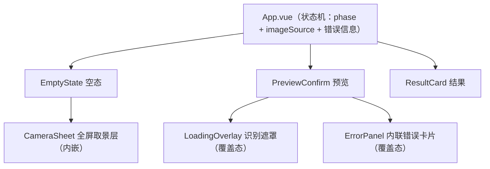

# 楼道消防隐患识别 功能设计文档

> 版本：v0.1（功能设计）｜日期：2026-10-28
>
> **文档边界**：本文档承接《楼道消防隐患识别应用 PRD》v0.1，回答"**页面怎么组织、每个功能的具体交互与呈现规范**"。PRD 已定的行为逻辑（状态机、五级标准、异常矩阵、接口约定）不重复、只细化；组件的 props/emits 签名、后端模块划分、依赖清单由开发过程自行沉淀。
>
> 决策来源：PRD D1–D8、S1–S10；本文新增 UI 层决策 **U1–U4**（2026-10-28 访谈确认）与细节默认项 **U5–U11**（本文内定稿，审稿可改）。

---

## 1. 页面结构与状态视图

单页应用，一个页面承载全部状态。**移动端优先**（场景 B 手机演示是验收通道），桌面端兼容：内容区 `max-width: 480px` 居中，桌面浏览器下呈现为居中窄栏——与手机视图同构，不单独设计桌面布局（U5）。

### 1.1 状态 ↔ 组件映射（U1）

PRD §4 状态机的五个状态，由 App.vue 统一持有状态机，向下映射为五个视图组件：

| 状态机状态 | 组件 | 职责 |
|---|---|---|
| 空态 | `EmptyState` | 两个图片来源入口 ＋ 摄像头降级说明；内含全屏取景层 `CameraSheet`（点"拍照"展开） |
| 预览 | `PreviewConfirm` | 待识别图片预览 ＋ 重拍/重选/取消/确认 |
| 识别中 | `PreviewConfirm` ＋ `LoadingOverlay` | 预览视图保持，图片上覆盖遮罩层，全部按钮禁用（U2） |
| 结果 | `ResultCard` | 缩略图 ＋ 结果大标签（U4） |
| 失败态 | `PreviewConfirm` ＋ `ErrorPanel` | 预览图保留，图下内联错误卡片（U3） |

App.vue 状态机字段（设计约定，非实现契约）：

- `phase`: `empty | preview | recognizing | result | error`——对应五态；
- `imageSource`: `camera | album`——记录当前图片来源，驱动"重拍/重选"按钮文案与"再拍一张"的回跳行为；
- `imageFile`: 压缩后的图片 File 对象，预览/识别中/失败态共享，失败态不清空（PRD §5.5）。

### 1.2 状态转换补充约定

PRD 状态机的两处细化澄清（U6）：

- **"结果 → 再拍一张"**：不回预览态，而是回空态并**直接调起原来源**——`imageSource === 'camera'` 且摄像头可用时直接展开取景层，否则直接打开文件选择器；
- **"预览 → 取消"**：清空 `imageFile` 与 `imageSource`，回空态；识别中不提供取消（PRD 既定）。

---

## 2. 空态与图片获取（F1＋F4）

### 2.1 空态布局

自上而下：应用标题（"楼道消防隐患识别"）→ 一句说明（"拍摄楼道照片，即时判断消防隐患等级"）→ 两个入口按钮 → 降级说明区（仅摄像头不可用时出现）。

### 2.2 摄像头探测与降级（F4）

- **时机**：`onMounted` 一次性探测，结果缓存于 App.vue，不重复探测；
- **判定**：`navigator.mediaDevices?.getUserMedia` 存在 **且** `window.isSecureContext === true`，两者同时满足才视为可用（局域网 HTTP 下 `isSecureContext` 为 false，即触发降级，覆盖多数手机浏览器场景）；
- **降级表现**：隐藏"拍照"按钮，仅保留"相册上传"；按钮下方出现说明文案（文案全集 §7-D2）。**只做特性探测，不实际调起摄像头流验证**（避免加载即弹权限框）；
- 摄像头权限被用户拒绝发生在点击"拍照"之后：取景层内提示（§7-D3），并提供"改用相册上传"出口——降级判定不回写入口可见性（刷新前保持现状）。

### 2.3 拍照（CameraSheet 取景层）

- 点击"拍照"→ 展开全屏取景层：`<video>` 实时取流铺满 ＋ 底部两个按钮（**截帧**、**关闭**）；
- 视频流生命周期：展开时 `getUserMedia({ video: { facingMode: 'environment' } })` 优先后置摄像头（U7）；**截帧或关闭时立即 `stop()` 全部 track 释放摄像头**（U8）；
- 截帧：当前视频帧绘入 canvas → 走 §2.5 压缩 → 关闭取景层 → 进入预览态；
- 取流失败（权限拒绝/无设备）：取景层内展示失败提示 ＋"改用相册上传"按钮（回空态并直接打开文件选择器）。

### 2.4 相册上传

- `<input type="file" accept="image/*">`，**单选**；
- 选中即走 §2.5 压缩，进入预览态；`change` 事件后将 input 值清空（保证选同一张图也能再次触发 change，U9）。

### 2.5 前端压缩（承接 S4，细化）

1. 读入图片（`createImageBitmap` 或 `Image` ＋ object URL）；
2. 长边 >1280px 时等比缩放至长边 1280px，否则保持原尺寸；
3. canvas 底先铺白色再绘制（避免 PNG 透明通道转 JPEG 变黑底，U10）；
4. `toBlob('image/jpeg', 0.8)` 输出——**无论来源格式，统一输出 JPEG**，文件名 `capture.jpg` / `upload.jpg`；
5. 压缩结果即 `imageFile`，是预览与上传的唯一图片对象（后续不再持有原图）。

### 2.6 前端预校验（U11，后端校验的前置防御）

- 类型：由 `accept` 与来源（截帧必为 JPEG）约束，前端不再拦截；
- 大小：压缩后仍 >10MB（极端情况）时直接进失败态，展示 `INVALID_FILE` 同款文案，不出网络请求。

---

## 3. 预览与确认（F2）

- **布局**：图片预览区（等比缩放，`max-height: 60vh`）居上，按钮组居下；
- **按钮组**（一行三钮）：
  - **重拍/重选**（次要按钮）：文案随 `imageSource` 切换——`camera` →"重拍"（回取景层）、`album` →"重选"（打开文件选择器）；替换图片后停留预览态；
  - **确认识别**（主按钮）：进入识别中；
  - **取消**（文字按钮）：清空图片回空态（§1.2）；
- 预览图即 `imageFile` 的 object URL，识别成功前不销毁。

---

## 4. 识别中（F3 前半，U2）

- 触发"确认识别"后：`imageFile` 以 multipart 上传 `POST /api/recognize`（PRD §6.1），前端同时进入识别中；
- **遮罩层**覆盖预览图：半透明黑底 ＋ spinner ＋ 文案"正在识别中…通常 10 秒内出结果"（§7-L1）；
- 预览页所有按钮禁用（视觉置灰），不提供取消；
- 前端对请求本身设 35s 兜底超时（后端 30s 超时 + 网络余量）：后端先返回则按后端结果，前端兜底超时触发时按网络异常处理（§6）。

---

## 5. 结果展示（F3 后半，U4）

### 5.1 ResultCard 布局

上半：被识别图片缩略图（确认"识别的是这张"）；下半：结果块 = 等级色块 ＋ 中文大标签 ＋ 判定标准一句话 ＋"再拍一张"主按钮。

### 5.2 五级结果呈现规格

色值沿用 PRD §2.1 色板（Element Plus）：

| level | 中文标签 | 色块 | 判定标准文案（结果页展示） |
|---|---|---|---|
| `high` | 高风险 | `#F56C6C` | 楼道中出现电动车、电瓶、飞线充电等可能起火的元素 |
| `medium` | 中风险 | `#E6A23C` | 大量堆积物严重影响通行，或堆放大量纸箱、木质家具等易燃堵塞物 |
| `low` | 低风险 | `#F7D75B` | 存在楼道堆物现象，但不严重 |
| `none` | 无风险 | `#67C23A` | 楼道干净，无堆放物品 |
| `not_corridor` | 非楼道 | `#909399` | ——（展示引导文案，见下） |

- `not_corridor` 特殊处理：不展示判定标准行，改展示引导文案（S9）："该图片不是楼道场景，请拍摄楼道照片"，主按钮文案改为"重新拍摄"；
- 模型原始输出不在前端展示（S3 既定），结果页无任何"理由"入口。

---

## 6. 失败态（F5，U3）

### 6.1 呈现方式

预览图保留原位，预览图**下方**内联渲染错误卡片：警告图标 ＋ 可读文案 ＋ 按钮组（**重试**＝同一张 `imageFile` 重新上传、**重新选择**＝回空态直接调起原来源）。预览页原有按钮组隐藏，仅保留错误卡片出口。

### 6.2 异常映射

| 触发 | 判定 | 文案（§7-E 系列） |
|---|---|---|
| 后端 400 | `error.code === 'INVALID_FILE'` | E1 |
| 后端 504 | `error.code === 'MODEL_TIMEOUT'` | E2 |
| 后端 502 | `error.code === 'MODEL_UNPARSABLE'` | E3 |
| 请求抛错 / 前端 35s 兜底超时 / 非 2xx 且无 code | 网络异常 | E4 |
| 前端预校验超 10MB（§2.6） | 本地判定 | E1 |

- 未知错误码一律走 E4 兜底，前端不做白名单之外的分支；
- 重试次数不设限（每次重试都是一次完整上传）。

---

## 7. 文案全集

| # | 场景 | 文案 |
|---|---|---|
| 空态标题 | 页面主标题 | 楼道消防隐患识别 |
| 空态说明 | 副标题 | 拍摄楼道照片，即时判断消防隐患等级 |
| 空态按钮 | 两个入口 | 拍照｜相册上传 |
| D2 | 摄像头降级说明 | 当前环境不支持摄像头，可通过相册选择照片 |
| D3 | 取景层调起失败 | 无法访问摄像头，请检查权限或改用相册上传 |
| L1 | 识别中遮罩 | 正在识别中…通常 10 秒内出结果 |
| E1 | 文件不合规 | 仅支持 jpg/png/webp 图片，且不超过 10MB |
| E2 | 模型超时 | 识别超时，请重试 |
| E3 | 解析失败 | 识别失败，请重试或换一张照片 |
| E4 | 网络异常 | 网络异常，请检查连接后重试 |
| R5 | not_corridor 引导 | 该图片不是楼道场景，请拍摄楼道照片 |
| 按钮 | 通用 | 确认识别｜重拍｜重选｜取消｜再拍一张｜重新拍摄｜重试｜重新选择 |

---

## 8. 决策记录

### 8.1 访谈确认（2026-10-28）

| # | 决策 | 结论 |
|---|---|---|
| U1 | 组件结构 | 按状态机拆子组件，App.vue 持有 `phase`/`imageSource`/`imageFile` |
| U2 | 识别中呈现 | 预览图上覆盖遮罩层，不整页切换 |
| U3 | 失败态呈现 | 预览图下内联错误卡片（对齐"失败不清空已选图片"） |
| U4 | 结果页信息 | 缩略图 ＋ 结果块并列，保留"照片 ↔ 结果"对照 |

### 8.2 细节默认项（本文内定稿，审稿可改）

| # | 项 | 默认值 |
|---|---|---|
| U5 | 页面布局 | 移动端优先，`max-width: 480px` 居中窄栏，不做独立桌面布局 |
| U6 | 再拍一张 | 回空态并直接调起原来源（拍照可用→取景层；否则→文件选择器） |
| U7 | 摄像头朝向 | `facingMode: 'environment'` 优先后置 |
| U8 | 视频流释放 | 截帧或关闭取景层立即 stop 全部 track |
| U9 | 文件 input | change 后清空 value，支持重复选同一张 |
| U10 | 压缩输出 | canvas 铺白底，统一输出 JPEG（质量 0.8，长边 ≤1280px） |
| U11 | 前端预校验 | 仅校验压缩后大小 ≤10MB；类型交由 accept 与后端兜底；前端请求 35s 兜底超时 |

---

## 9. 与后续工作的衔接

- 本文档 ＋ PRD 即为开发的完整行为依据；组件签名、后端模块划分、工程脚手架在开发中沉淀；
- 建议开发顺序：后端 `/api/recognize`（可用 curl 先行验收五分类正确性）→ 前端骨架与状态机 → 拍照/压缩链路 → 降级与异常路径 → 双通道验收自查（PRD §9）。
