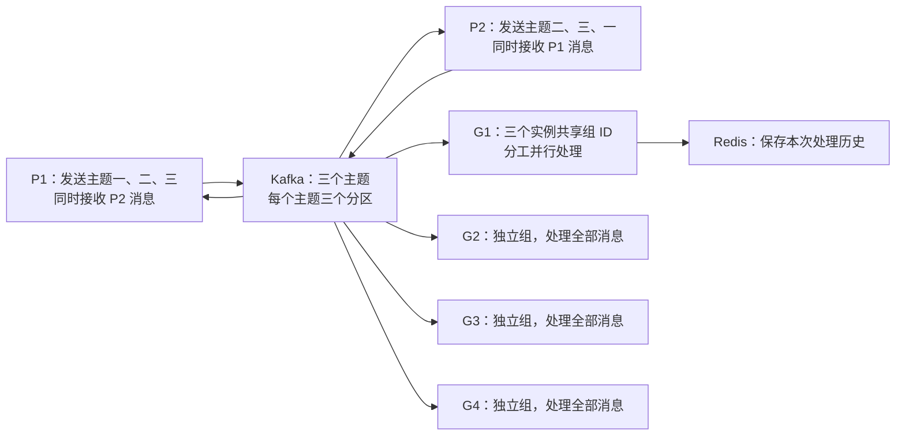

# Redis 与 Kafka：本地流程演示

这个工程用一次自动演示观察 Kafka 如何传递消息，以及 Redis 如何保存处理后的记录。程序在本机 Python 环境运行，Redis 和 Kafka 服务在本机 Docker Desktop 中运行。



## 程序运行流程

```text
启动本机服务 → 创建三个主题 → 等订阅者就绪 → P1/P2 定时发布
                                           ↓
                         各消费组同时处理、Redis 记录 G1 结果
                                           ↓
                           等待积压处理完 → 读取 Redis 并核对
```

1. `demo.py` 读取 `.env`，启动本机 Redis 和 Kafka，等待两个服务可连接，再创建主题一、二、三（各三个分区）。
2. 启动八个订阅实例并等待它们准备好：G1 有三个实例；G2、G3、G4 各一个；P1、P2 各有一个接收对方消息的订阅实例。
3. P1 从主题一开始、P2 从主题二开始，按三个主题轮换；两者各发送六条，每隔 0.2 秒发送一次。发送线程和订阅线程同时运行，所以 P1/P2 可以边发边收。
4. 每个消费者收到消息后模拟处理一秒。G1 的三个实例分摊消息，处理完成后写入 Redis；G2、G3、G4 各自处理全部消息。发送比处理快，终端先看到积压增加，发送结束后再看到各组追赶完成。
5. 程序等待所有组处理完毕，从 Redis 重新读取本次历史并核对 12 条记录，然后打印 G1–G4 各处理 12 条、P1/P2 各接收对方六条的汇总。

## 工程目录

```text
project--02/
├─ demo.py                # 完整演示程序
├─ docker-compose.yml     # 本机 Redis、Kafka 服务
├─ .env                   # 本机连接地址
├─ requirements.txt       # 固定版本的 Python 依赖
├─ offline/
│  ├─ docker-images.tar   # Redis、Kafka 离线镜像
│  └─ wheels/             # Python 依赖离线安装包
├─ README.md              # 流程与运行方法
└─ TECHNICAL.md           # 实现细节
```

## 离线部署与运行

把整个 `project--02` 目录复制到另一台电脑。该电脑需预装 Python 3.12（含 pip）和 Docker Desktop，并启动 Docker Desktop 的 Linux 引擎；导入镜像与安装依赖的过程不需要联网。在 PowerShell 中进入复制后的目录：

```powershell
conda activate py312
docker load -i .\offline\docker-images.tar
python -m pip install --no-index --find-links .\offline\wheels -r .\requirements.txt
```

如果没有 Conda，也可直接使用 Python 3.12。安装完成后，每次演示只需一条命令，程序会自动启动两个容器：

```powershell
python demo.py
```

终端每行都有类型标记：`[+] [发送]` 表示生产者发布，`[>] [处理]` 表示消费者开始处理，`[v] [完成]` 表示处理结束，`[#] [进度]` 表示积压快照，`[@] [Redis]` 和 `[=] [汇总]` 表示最终核对。进度每发布三条打印一次，便于跟踪而不遮住消息流程。

G1 的三个实例共享一个消费组，**同一条消息只由其中一个实例处理**；G2、G3、G4 使用不同消费组，所以**每组都会处理全部 12 条消息**。慢组会暂时积压，随后继续处理，并非自动丢失消息。

运行完成后可以用 `docker compose down` 停止服务；Redis 历史保存在 Compose 数据卷中。分区、提交和失败行为见 [技术说明](TECHNICAL.md)。
