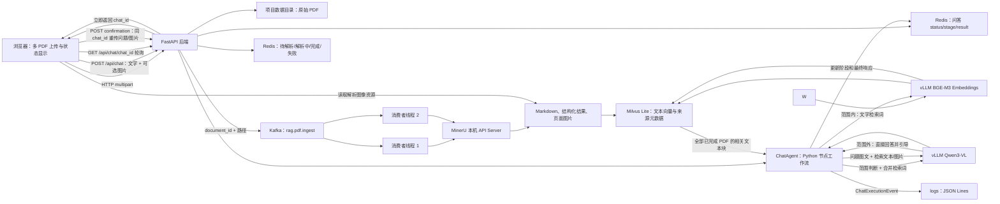

# Kafka 多模态 RAG 问答设计

## 目标

先在本地开发和验证，再将工程复制到优云 `/workspace/project03` 做云端联调；云端不使用 Docker。复刻一个可运行的多模态 RAG 问答工程。工程前后端分离：网页可一次上传多个 PDF 并查看解析状态；后端经 Kafka 异步调度 MinerU 解析；用户可用文字和图片提问，回答支持图文混排。

## 已知环境与约束

- 本地源码工作区：`E:\4.嵌入式AI学习\test_demo\project--03`；使用本机 Conda py312 环境开发，项目兼容 Python 3.12 和 3.13，以云端 Python 3.12 为部署基准。未激活环境时系统默认 Python 为 3.13.9。
- 云端部署目录：`/workspace/project03`，已确认可写且实例重启后会保留；云端 Python：3.12.11；GPU：NVIDIA GeForce RTX 4090，驱动已可用。
- 本地允许使用 Docker 启动 Kafka 和 Redis；云端容器无法启动 Docker daemon，因此云端部署不依赖 Docker。
- 已安装 Kafka、Redis、MinerU、vLLM；向量存储改为 Milvus Lite。
- **云端 MinerU Python 依赖：** `mineru[torch]>=4.0,<5`；云端已解析安装版本为 `4.2.1`，Python 为 `3.12.11`。MinerU 使用独立 Python 环境，由后端通过本机 API Server 调用；任务 API 按 4.2.1 的 `/v1/tasks` 契约实现。
- MinerU 客户端每次仅提交一个 PDF：`POST /v1/tasks` 使用 JSON 文件清单；只有返回上传动作时才按响应 URL 和请求头执行 `PUT`，之后以 `task_id/file_id` 轮询 `GET /v1/tasks/{task_id}`，并直接下载 `result_url`。解析产物请求 `default` ZIP，含 Markdown、结构化内容和图片。
- MinerU 任务默认每 2 秒轮询，最长等待 1800 秒，可通过 `RAG_MINERU_POLL_INTERVAL_SECONDS` 和 `RAG_MINERU_TASK_TIMEOUT_SECONDS` 调整。创建任务的 POST 没有客户端幂等键；若传输超时且无法确认服务端是否已接收，文档标记失败并交由用户重传，不盲目创建第二个任务。只有服务明确以 `server_shutting_down` 拒绝接单时，才进入既有 Kafka 有限重试策略；解析终态失败、轮询超时或产物下载失败不自动新建解析任务。
- **版本提示：** [PyPI MinerU 4.2.1](https://pypi.org/project/mineru/4.2.1/) 标记为 yanked，说明 Linux 任务可能卡住无法完成。当前实现按云端现有版本接入，不会自动升级；云端真实解析验收时需关注这一已知问题。
- **云端 Milvus Python 依赖：** `pymilvus[milvus-lite]==3.0.2`，`milvus-lite==3.2.2`。后续 Milvus Lite 适配按云端已安装版本兼容。
- **索引与摘要已确认约定：** 文本按页切块，段落优先、句子其次，目标 800 字符、相邻块重叠 120 字符；不跨页合并，页级图片 ID 随该页文本块保存。BGE-M3 使用 1024 维向量。Qwen3-VL 从 MinerU 标题/目录和页面正文生成标题与短摘要；资料库概览只汇总 completed 文档摘要。
- MinerU 使用独立 Python 环境；vLLM 使用独立环境，部署 `BAAI/bge-m3` 生成文本向量。
- 问答使用云端 RTX 4090 上由 vLLM 提供的 `Qwen/Qwen3-VL-4B-Instruct` 视觉模型；后端通过 OpenAI Python SDK 调用本机兼容接口。
- 本地没有模型服务；本地开发验证使用真实 Kafka/Redis，MinerU 和 vLLM 接口由测试替身代替，真实模型解析与问答在云端验证。
- 本地开发配置与云端配置分离；不把云端密钥写入源码。
- 云端 Kafka、Redis、Milvus Lite、原始 PDF、解析结果、图片、模型缓存和应用日志统一放在 `/workspace/project03` 下。

## 方案与取舍

1. **浏览器直接访问 Kafka**：不采用。浏览器不直接操作 Kafka broker，认证和网络暴露也不适合由前端承担。
2. **HTTP 上传后把 PDF 二进制直接放入 Kafka**：不采用。PDF 可能很大，不适合作为 Kafka 消息载荷。
3. **前端 HTTP 上传、后端保存文件并向 Kafka 发送任务元数据（采用）**：后端先落盘，再按 PDF 发布包含 `document_id` 和相对路径的消息；两个 Kafka consumer 以相同消费组 ID 订阅三分区任务主题，由 Kafka 分配分区并行处理不同 PDF。消费者调用本机 MinerU API Server。Kafka 只分发小型任务消息，不传输大文件。MinerU API Server 常驻，使解析模型在任务间复用，并用 Tasks API 查询和下载解析产物。

## 任务 5：切块、向量与资料库概览

- **切块：** 每页独立切分，优先段落边界，其次句子边界；目标长度 800 个 Python 字符、重叠 120 字符，硬上限 800 字符。空白页不创建文本块。每块复制该页关联的 `asset_ids`，稳定 `chunk_id` 为 `document_id/page_number/chunk_index/text` 的 SHA-256。
- **Embedding：** 使用 OpenAI Python SDK 调用 vLLM BGE-M3，依输入顺序分批（每批 32 条），检查响应条目数、1024 维度和有限数值。SDK 依赖范围为 `openai>=1.0,<3`，以兼容当前 vLLM OpenAI 兼容接口。
- **Milvus：** collection 名称为 `rag_chunks`；主键 `chunk_id`，并存文档 ID、页码、页内块序号、正文、图片 ID 数组和 1024 维 COSINE 向量。数据库路径相同的 `MilvusChunkStore.from_path()` 在单进程内复用同一客户端；同一实例用一把锁串行 upsert，每批最多 256 块。
- **摘要：** Qwen3-VL 返回 JSON `title` 和 `summary`。输入最多 16,000 字符，其中 Markdown 标题/目录最多 4,000 字符，余量用于 MinerU 页面正文；该上限避免整本 PDF 一次送入模型。
- **完成与概览：** 索引和摘要成功后，Redis 在同一个事务内写入文档 `completed` 状态及从 completed 文档摘要重建的 `rag:corpus:profile`。共享 Redis store 的完成锁串行同进程 consumer 更新；事务失败时 Kafka 不提交该消息的 offset。当前每次完成都线性扫描文档状态，后续规模增大可增加 completed 索引。Kafka 重投使用相同 chunk ID upsert，不增加重复向量。
- **重试：** Embedding、摘要或 Milvus 写入错误沿用文档处理的最多 4 次、1/2/4 秒退避。向量 upsert 可幂等重放；Redis 状态与资料库概览一起写，避免仅其中一项更新成功。
- **验证范围：** 单元测试以固定向量、固定摘要和 Redis/Milvus 替身覆盖数据契约与失败行为。真实 BGE-M3、Qwen3-VL、Milvus Lite 联调留到云端部署阶段。

### 任务 6：问答检索边界

- 范围内问题检索 Top-5 chunk，与黄金集 Hit@5 指标对齐；查询仅过滤 Redis 中 status 为 completed 的 document_id。
- Qwen3-VL 单独执行证据充分性判断，不使用 cosine 阈值；它读取用户问题文本和检索到的 PDF 文本，不读取用户图片，避免把用户图像本身当成 PDF 证据。
- 证据不足时返回 `needs_confirmation`，不调用最终答案生成；接受证据时最终回答模型接收原问题、用户可选图、Top-5 PDF 文本和最多 3 张去重的关联 PDF 图片。
- 用户图不占用 3 张 PDF 图片额度，单次最终请求最多包含 4 张图片。vLLM OpenAI 兼容接口支持多图输入；服务端 `--limit-mm-per-prompt` 需配置为至少 4。详见 [vLLM 多模态输入文档](https://docs.vllm.ai/en/stable/features/multimodal_inputs/)。
- 最终回答只能引用本次检索返回的 chunk_id 和已验证的 asset_id；服务端将模型给出的来源 ID 与检索结果取交集，再生成公开响应，避免模型伪造来源或图片路径。

## 目标流程

## 用户可见行为

- 上传区支持多 PDF 一次提交，并为每份文件显示“待解析、解析中、解析完成、解析失败”状态；前端定时向后端查询状态。
- 问答输入允许文本和可选图片同时提交。
- 回答按 Markdown 文本和受控的本地图片资源 URL 混排显示；回答附来源文档、页码或区块引用。
- 已完成解析的 PDF 可重复参与问答，不重复解析。

## 核心实现

### 前端

- 独立静态网页，原生 HTML/CSS/JavaScript，不增加前端构建链。
- 通过 HTTP multipart 上传多个 PDF；接收每个文件的 `document_id`，轮询状态接口。
- 问答请求通过 multipart 传递文本与可选图片；响应中包含可渲染的回答、引用和本地图片资源。

### 后端与 Kafka

- FastAPI 负责静态前端、上传、状态、问答和图片资源接口。
- 上传时校验扩展名、文件大小和 PDF 文件签名，生成唯一 ID，并安全地保存到 `data/uploads/`。
- 每个文件发布一条 JSON Kafka 消息，只含任务 ID、文件 ID、文件相对路径、提交时间和重试计数。
- FastAPI 运行单 Uvicorn 进程；进程内启动两个 consumer 线程，各自拥有 KafkaConsumer 实例并使用同一 group_id，避免跨线程共享 KafkaConsumer。
- consumer 在所属线程内创建并关闭；每条消息单独提交 `offset + 1`，仅在 completed/failed 状态写入 Redis 后提交。遇到处理或提交异常时回退到当前消息 offset，避免同一 poll 批次的后续消息越过失败任务被确认。
- 可重试服务错误最多尝试 4 次，间隔默认 1/2/4 秒；永久输入错误不重试。已持久化为 completed 的重复消息直接确认，其他可能重复的解析/索引写入仍由稳定 ID 保证幂等。
- 无法解析为任务事件的 Kafka 消息没有可关联的 `document_id`；worker 记录错误后提交该条消息，避免无效载荷永久阻塞分区。
- 两个消费者可以并行领取并处理不同 PDF；共享该进程中的唯一 Milvus Lite 客户端，向量写入加锁串行化。稳定 chunk_id 使失败重投可以幂等 upsert。
- 每个消费者以手动提交偏移量处理任务：更新 Redis 状态、调用 MinerU Tasks API、解析产物、切块、请求 embedding、写入 Milvus Lite；完成状态和结果持久化成功后再提交偏移量。
- 对重复投递以稳定的 document/chunk ID 做幂等写入；失败记录错误状态和日志，有限次数重试，超限后保留失败状态供用户查看。

#### Redis 文档状态读取错误边界

- 文档状态使用 Redis 字符串 key/value 保存：key 为 `rag:document:{document_id}`，value 为 `DocumentRecord` 的 JSON 字符串。
- `GET` 返回 `None` 表示文档不存在；Redis 连接或命令错误转换为“Redis 文档状态读取失败”。
- Redis 客户端可能返回 UTF-8 字节串，也可能配置为直接返回字符串。字节解码和 JSON/数据模型还原放在同一格式校验边界内。
- 无效 UTF-8、损坏 JSON、缺少必需字段或枚举/时间字段非法，统一转换为“Redis 文档状态格式无效”；通过异常链保留底层原因。只捕获预期的格式异常，不把任意程序错误伪装成数据损坏。
- 单元测试覆盖字节串与字符串的正常读取、无效编码、无效 JSON、缺字段和 Redis 读取故障。

### MinerU 解析和多模态资料

- MinerU API Server 绑定 `127.0.0.1`，仅供后端消费者访问。
- 解析输出保存到 `data/parsed/<document_id>/`；Markdown/结构化内容切成带文档、页码和段落顺序元数据的文本块。
- MinerU 导出的图像留在同一文档目录；图片 URL 由后端受控接口提供，不直接暴露任意磁盘路径。
- 文本向量使用 vLLM 提供的 BGE-M3 `/v1/embeddings`；Milvus Lite 数据库位于 `data/milvus_lite.db`。

### 多模态问答

- Redis 为每份已解析 PDF 保存自动生成的标题和摘要；Qwen3-VL 在检索前接收用户图文及资料库主题摘要，先判断相关性并整理合并检索词。
- 范围外问题不访问 Milvus，Qwen3-VL 直接作答并引导用户询问资料库相关主题。
- 范围内问题默认搜索全部已完成 PDF；BGE-M3 将合并后的文字检索词向量化，Milvus Lite 返回相关文本块和关联资源。
- 用户原图、检索文本和相关文档图片一起提交给 Qwen3-VL。
- 相关问题若没有足够证据，明确告知资料中未找到依据，并询问用户是否需要通用回答。
- vLLM 为 BGE-M3 embedding 和 Qwen3-VL 问答分别提供 OpenAI 兼容服务；Python 后端使用 OpenAI SDK，并通过本地 Base URL 和模型名配置调用，不需要 DeepSeek API Key。
- 两个 vLLM 服务与 MinerU 共用一张 4090；限制解析并发并设置模型显存预算，避免加载和推理时显存互相挤占。
- 后端仅允许回答引用本地已存在的文档图片 ID；前端将这些图片与回答文本一并渲染。

#### 问答工作流组织方式

问答采用显式 Python 节点工作流：由 `ChatAgent` 持有统一状态，并按范围判断结果调度范围外直接回答、范围内检索、证据判断和最终生成等节点。各节点使用明确的输入/输出字段；提示词模板放在独立的 `backend/app/prompts/chat/`，模型和存储调用通过 integrations 适配器完成。

备选方案是使用 LangGraph 定义状态图。它适合分支增多、需要检查点恢复或人工介入的工作流，但当前问答分支有限，引入框架会增加依赖和学习成本。因此第一版采用显式 Python 节点组织，保留以后按需迁移的空间；此选择不影响通过 OpenAI Python SDK 调用 vLLM 的接口方式。

#### 问答任务状态和运行日志

- `ChatState` 是单次 Agent 执行期间的内存状态，记录用户问题、可选图片、资料库摘要、当前节点、路由、检索词、证据和响应，供 Python 节点传递数据。
- `ChatStatusRecord` 是可查询的问答任务状态，写入 Redis。状态为 `accepted`、`running`、`completed`、`needs_confirmation`、`cancelled` 或 `failed`；执行阶段为 `scope_and_rewrite`、`retrieval`、`evidence_check`、`answer_generation` 或 `awaiting_confirmation`。范围识别和检索词整理合并为一个模型节点。
- 前端通过 `POST /api/chat` 提交图文问题并立即获得 `chat_id`，然后轮询 `GET /api/chat/{chat_id}`；后端更新 Redis 状态，完成后在状态结果中返回回答和引用。问答任务在后端进程内执行，不经 Kafka；状态更新不能阻塞 Agent 节点。
- 证据不足时任务停在 `needs_confirmation`。用户选择继续通用回答时，前端通过 `POST /api/chat/{chat_id}/confirmation` 重传原问题和可选图片并沿用原 `chat_id`；接受后从 `answer_generation` 继续，拒绝后进入 `cancelled`。服务端不为此长期保存原问题或图片。
- `ChatExecutionEvent` 是结构化运行日志事件，记录 `chat_id`、时间、阶段、开始/结束/失败事件、耗时、模型名、检索数量和错误代码，写入 `logs/chat.jsonl`。每行是一个独立 JSON 对象；不记录完整问题、图片、提示词或检索正文。日志使用大小轮转，单文件默认 10 MiB、保留 5 个历史文件。
- 问答使用单个进程内 FIFO 队列，默认并发 1、等待容量 16（不含执行中的任务），均可通过 `RAG_CHAT_MAX_CONCURRENCY`、`RAG_CHAT_QUEUE_CAPACITY` 配置；队列满时 HTTP 429 拒绝，且不创建状态记录。可配置服务端并发高于 1 时，多个 worker 按 FIFO 顺序领取任务，但结束顺序可能不同。
- Redis 问答状态默认 TTL 为 7 天，可用 `RAG_CHAT_STATUS_TTL_SECONDS` 配置。启动时把遗留 `accepted`/`running` 状态标记为 `failed`，供客户端重新提交。
- 用户问题与图片只暂存在内存任务队列；单张图默认最多 10 MiB，可通过 `RAG_MAX_CHAT_IMAGE_BYTES` 调整，超限返回 HTTP 413。用户接受通用回答时必须重传原问题和可选图片，服务端不保存对话正文或图像到 Redis。
- 若后端进程在问答中重启，进程内运行任务会中断；遗留的 `accepted`/`running` 状态在重新启动后标记为失败并提示用户重试。问答状态 TTL 默认 7 天，日志按 10 MiB 大小轮转并保留 5 份。
- 问答使用单个进程内 FIFO 队列，并发默认 1、等待容量默认 16；图片单张默认最多 10 MiB。继续通用回答必须重传问题和可选图片；该分支只调用回答生成，不重新检索。

## 本地开发与云端运行

- 本地源码保存在仓库；配置通过 `.env.example` 与本地 `.env` 管理，`.env` 不复制进版本库。
- 前端源码放在独立 frontend/ 目录；后端 API、Kafka 消费者和业务逻辑放在独立 backend/ 目录。FastAPI 可托管静态前端文件，减少本地及云端额外 Web 服务。
- 本地通过 Docker Compose 启动 Kafka/Redis，使用 py312 环境验证前端交互、HTTP API、三分区主题的两个 consumer 分配、Kafka 消息流、Redis 状态和 Milvus Lite；MinerU 与 vLLM 调用使用测试替身。
- 黄金集评测代码放在 `backend/tests/evaluation/`；本地用替身验证评测流程，连接真实 MinerU 和 vLLM 的 33 条黄金集在云端运行。评分 Agent 复用 Qwen3-VL，按确定性指标与大模型质量评分分工，提示词和问答 Agent 分离。
- 云端再验证 GPU 模型、MinerU、vLLM Qwen3-VL 问答与 BGE-M3 embedding、Milvus Lite 的整条真实链路。
- 创建 Linux 云端运行脚本 `scripts/start.sh`、`scripts/stop.sh`、`scripts/status.sh` 和日志目录；在无 systemd 的优云实例中使用 PID 文件和 `nohup` 管理进程，并提供优云 `/start.d/` 启动入口。
- 云端 MinerU API Server、vLLM embedding server、vLLM 问答 server、解析消费者和 FastAPI 均以非 Docker 进程运行；Kafka、Redis 使用已安装的本机服务。
- 云端 Kafka、Redis、Milvus Lite、原始 PDF、解析结果、图片、模型缓存和应用日志均采用 `/workspace/project03` 下的固定目录。
- Web 服务按优云端口映射要求监听可访问地址；Kafka、Redis、vLLM 和 MinerU 仅监听回环地址。

## 范围外

- 不实现账号体系、多租户权限、云端对象存储、分布式 Kafka 集群或多机向量数据库。
- 不把 PDF 二进制直接写入 Kafka。
- 不依赖外部生成模型 API；Qwen3-VL 和 BGE-M3 均由云端 GPU 上的 vLLM 本地提供。

## 成功标准

1. 同时上传多份 PDF 后，每份都产生 Kafka 任务，并能在网页看到状态推进到完成或明确失败。
2. 完成解析的 PDF 内容及图片保存在项目数据目录，文本块向量写入 Milvus Lite。
3. 纯文本问题能基于已上传 PDF 检索并回答，结果带文档来源。
4. 文本和用户图片可共同送入 vLLM 中的 Qwen3-VL；回答可在文本段落间渲染检索到的 PDF 图片。
5. 重启应用进程后，已完成文档和向量仍可查询；脚本能查看并管理所有服务进程。
