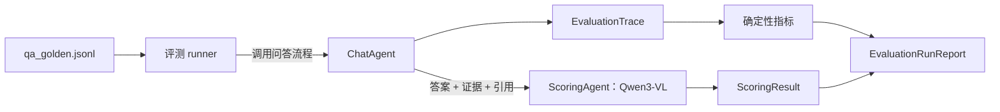

# 多模态 RAG 验证集设计

## 目标

使用项目根目录的《NLP领域五大QA问答场景总结：FQA、DOC-QA、KBQA、TableQA、TaskQA等场景概述与对比解析》作为首个验证 PDF，验证上传解析、文本/图片索引、范围判断、合并检索、证据引用、图文问答、任务状态和运行日志。

这是单文档的首轮回归基线，能检查五种问答表达形式和主要分支，但不能据此证明系统对不同领域、多文档冲突或大规模资料库都具有同等效果；后续应随真实资料库增加多文档验证集。

这份资料介绍五种 QA 类型，不代表本系统要实现 FAQ 技能训练、知识图谱数据库或外卖/业务执行接口。验证目标是：系统能够忠实检索和回答 PDF 中的内容；遇到文档未提供的事实时不编造；遇到执行类请求时说明系统能力边界。

## 验证集格式

建议保存为 `backend/tests/fixtures/evaluation/qa_golden.jsonl`，一行一条用例。图像输入样例放在同目录的 `images/` 子目录。

```json
{
  "id": "TBL-01",
  "category": "TableQA",
  "question": "X50 支持无线充电吗？",
  "expected_route": "in_scope",
  "expected_behavior": "answer",
  "required_answer_points": ["X50 不支持无线充电"],
  "assertions": ["请求调用 Milvus 并命中第 4 页证据"],
  "evidence_pages": [4],
  "input_image": null
}
```

字段说明：

- `id`：稳定用例编号。
- `category`：FQA、DOC-QA、TableQA、KBQA、TaskQA，或跨类别的 `scope`、`multimodal`。
- `question`：用户问题。
- `expected_route`：预期范围判断，值为 `in_scope` 或 `out_of_scope`。
- `expected_behavior`：预期回答类型，如 `answer`、`abstain`、`capability_boundary`、`mixed_media`。
- `required_answer_points`：人工或评测程序检查的必要事实点，不要求模型逐字复述。
- `assertions`：检查系统行为的断言，例如是否调用检索、是否进入确认状态、图片是否传入模型。
- `evidence_pages`：参考 PDF 页码；运行时再映射到实际 `document_id` 和 chunk 引用。
- `input_image`：可选用户图片 fixture 相对路径。

## 评分 Agent

评分 Agent 是测试评测组件，不参与用户问答，也不向用户返回分数。首版复用 vLLM 上已部署的 Qwen3-VL，通过独立 `ScoringAgent` 和评测提示词评分，不再增加常驻模型服务。评分输入包含问题、预期行为、必要答案点、生成答案、检索到的证据块及来源/页码、系统返回的引用；图像用例也把对应 fixture 交给评分模型。



评分 Agent 判断答案语义质量和证据支持情况。范围路由、Top-5 是否命中标注页、引用 document/page 是否正确、状态是否按预期流转、用户图片是否传入模型、混排响应是否包含有效 asset_id，均由评测代码确定性检查。

### 单条答案评分标准

每个维度按 0–5 分评分，换算为 100 分总分：

| 维度 | 权重 | 5 分标准 | 3 分标准 | 0–1 分表现 |
|---|---:|---|---|---|
| 事实正确性 | 35% | 必要答案点正确，无关键错误 | 主要结论正确，但遗漏一个重要事实点或有轻微不准确 | 核心事实错误、答非所问或没有有效答案 |
| 证据忠实度 | 35% | 每项事实都能由给定证据支持，没有编造 | 大部分有依据，但有一项推断超出证据或引用支持不完整 | 主要结论缺少证据、与证据冲突或捏造内容 |
| 完整性 | 20% | 覆盖问题所有子项和必要答案点 | 覆盖主体，但漏掉一个重要子项 | 大部分子项未答 |
| 行为符合度 | 10% | 正确执行回答、拒答/询问确认、能力边界等预期行为 | 形式基本正确，但确认或引导不清楚 | 应拒答却编造、声称执行了不存在的操作，或未按预期处理 |

总分公式：四个维度全部适用时，`事实正确性×7 + 证据忠实度×7 + 完整性×4 + 行为符合度×2`。如某维度不适用，则从分子和权重总和中移除该维度，再按剩余权重归一到 100 分。用例总分达到 **80 分**，且事实正确性、证据忠实度等关键适用维度不低于 **4 分**，才算评分通过。确定性断言失败时，该用例直接失败，不由评分 Agent 覆盖。

各维度统一使用以下中间分锚点：4 分表示整体满足要求、仅有轻微非关键问题；2 分表示有明显错误或遗漏，只满足部分要求；0 分表示没有可用内容或结论完全相反。1 分表示大部分错误，3 分表示基本方向正确但存在明显遗漏。对 `answer_and_guide` 的范围外问题，事实正确性和证据忠实度记为不适用，评分 Agent 只评估回复完整性和引导行为；是否确实没有触发检索由代码断言检查。拒答/证据不足用例仍评估事实正确性和证据忠实度，正确指出文档没有依据且不编造可得高分。

以下情况设置 `fatal_flags` 并直接判失败：证据不足时编造具体答案；关键结论与检索证据相反；声称执行了实际上不存在的外部操作；引用证据明显不能支持答案。普通的格式或措辞瑕疵不设为硬失败。

评分 Agent 返回结构化 `ScoringResult`：`case_id`、四个维度原始分、`fatal_flags`、缺失答案点、无依据主张、简短评分理由和引用证据 ID。总分、`passed` 和最终用例结果由 Python 评测代码根据原始分及确定性断言计算，避免让大模型负责算术或覆盖硬断言。评分 Agent 必须依据题目给出的参考答案和证据评分，不得凭自身常识补充标准答案。Mate40 冲突用例要求同时指出两处证据；无证据用例将明确说明未找到视为正确回答，不因未给出事实答案而扣分。

```json
{
  "case_id": "TBL-01",
  "dimension_scores": {
    "correctness": 5,
    "grounding": 5,
    "completeness": 5,
    "behavior": 5
  },
  "fatal_flags": [],
  "missing_points": [],
  "unsupported_claims": [],
  "evidence_refs": ["document_id:page:4"],
  "rationale": "回答与表格内容一致，来源页码支持该结论。"
}
```

`dimension_scores` 的取值为 0–5；不适用项用 `null`。总分和通过状态由 `EvaluationCaseResult` 计算。示例只说明评分 Agent 输出格式。

评分结果必须通过 `ScoringResult` 结构校验；无法解析时该用例记为评测错误，不能默认为通过。范围外用例不要求文档引用，其证据忠实度记为不适用，并对其他适用维度权重重新归一。首轮至少人工复核五类核心 QA 各一条及所有硬失败样例；复核结果用于校准评分提示词。

### 评测数据和结果类型

- `EvaluationCase`：从 JSONL 读取的黄金用例。
- `EvaluationTrace`：测试运行器收集的实际路由、Top-5 chunk/page、各阶段、引用、图片调用标记和响应；通过仅供测试注入的 trace collector 获取，不加入公开 HTTP 响应。
- `ScoringResult`：评分 Agent 对单条答案的结构化评分。
- `EvaluationCaseResult`：合并确定性断言和评分结果，记录单条用例是否通过。
- `EvaluationRunReport`：记录运行时间、数据集版本、回答模型、评分模型、提示词版本、各项指标、通过率和失败用例。

建议代码放在 `backend/tests/evaluation/`：`runner.py`、`metrics.py`、`schemas.py`、`agents/scoring_agent.py`、`prompts/scoring.md`。黄金 JSONL 和图片 fixture 保持在 `backend/tests/fixtures/evaluation/`。全模型评测通过独立命令或 pytest marker 启动，不混入每次快速单元测试。

## 黄金问题

验证集共 **33 条**：五类核心问题各 4 条（20 条），范围外 5 条，证据不足 5 条，图文输入/输出 3 条。参考页码按该 PDF 阅读器显示的 1–6 页记录。

| ID | 类型 | 问题 | 期望答案要点 | 证据页 | 验证重点 |
|---|---|---|---|---:|---|
| FAQ-01 | FQA | 购物车可以添加多少件商品？ | 100 件 | 1 | FAQ 直接问答检索 |
| FAQ-02 | FQA | 购物车的商品数量上限是多少？ | 100 件 | 1 | 同义改写仍命中同一证据 |
| FAQ-03 | FQA | 文档中的会员有多少项特权？ | 七项；文档没有列出具体名称 | 1 | 区分已知数量和未知详情 |
| FAQ-04 | FQA | 商品支持多少天内退换货？ | 15 天内 | 2 | 跨页检索短事实 |
| DOC-01 | DOC-QA | DOC-QA 适合哪些使用场景？ | 业务文档积累场景，例如景区介绍、企业制度/党章党规查询 | 2 | 段落理解与概括 |
| DOC-02 | DOC-QA | 文档提到支持上传哪些文件格式？ | txt、doc、docx | 2 | 从正文抽取枚举值 |
| DOC-03 | DOC-QA | 示例中的手机及其附件三包有效期分别是多少？ | 手机主体 1 年；电池 6 个月；外接有线耳机 3 个月；充电器、移动终端卡、数据接口卡 1 年 | 2 | 多事实完整性 |
| DOC-04 | DOC-QA | 三包期内消费者可以要求什么，办理时要提供什么凭证？ | 可要求修理、更换、退货；应提供发货票和三包凭证 | 2 | 组合多个相邻证据点 |
| TBL-01 | TableQA | X50 支持无线充电吗？ | 不支持 | 4 | 表格行列定位 |
| TBL-02 | TableQA | Mate40 和 iPhone12 的价格分别是多少？ | 表格中均为 6999 元 | 4 | 跨行字段读取与比较 |
| TBL-03 | TableQA | 表格中有几款手机支持无线充电？ | 3 款：Mate40、mi10、iPhone12 | 4 | 表格聚合计数 |
| TBL-04 | TableQA | 文档里 Mate40 的价格写了多少？ | 示意图写 6000 元，手机型号表写 6999 元；需指出来源不一致并引用两页 | 3、4 | 冲突证据识别，不可擅自消解 |
| KBQ-01 | KBQA | 《机械设计基础》的作者是谁？ | 杨可桢、程光蕴、李仲生 | 5 | 从知识三元组样例取实体属性 |
| KBQ-02 | KBQA | 《高等数学》由哪个出版社出版？ | 武汉大学出版社 | 5 | 关系查询 |
| KBQ-03 | KBQA | 《线性代数》的出版时间是什么？ | 2013-12-30 | 5 | 日期字段精确抽取 |
| KBQ-04 | KBQA | 文档列出了哪些知识图谱问答类型？ | 多跳、多限定、序数、是否、计数等 | 5 | 对枚举知识归纳 |
| TASK-01 | TaskQA | “我想订一份鸡排饭”这个例子要抽取什么信息？ | 数量为一份，种类为鸡排饭；再调用外卖服务 | 6 | 意图参数/词槽理解 |
| TASK-02 | TaskQA | 文档里的“词槽”和“特征词”有什么区别？ | 词槽是影响理解且影响结果的关键信息；特征词影响理解但不影响结果 | 6 | 概念对比 |
| TASK-03 | TaskQA | 文档举了哪些任务式问答场景？ | 下单/退货、差旅申请、会议室预定、听音乐、订外卖等 | 6 | 多场景枚举 |
| TASK-04 | TaskQA | 你能直接帮我下单一份鸡排饭吗？ | 说明 PDF 以此作为任务问答示例；当前 RAG 系统只回答文档，不具备真实外卖下单能力 | 6 | 不把文档示例误当成已接入工具 |
| SCOPE-01 | 范围 | 帮我写一首关于春天的诗。 | 识别为资料库范围外；可以通用回复并引导询问文档涉及的 QA 类型 | 无 | 范围外不得调用 embedding/Milvus |
| SCOPE-02 | 证据不足 | 文档中会员的七项特权分别叫什么？ | 说明资料只提到“七项特权”，没有给出名称；询问是否需要通用回答 | 1 | 相关但证据不足时不编造 |
| SCOPE-03 | 范围外 | NLP 中 Transformer 的注意力机制如何计算？ | 识别为当前资料范围外，通用回答并引导回文档主题 | 无 | 同属 NLP 大领域但不在本文资料范围 |
| SCOPE-04 | 范围外 | 明天上海天气怎么样？ | 识别为范围外，不查询资料库并引导回文档主题 | 无 | 时效性问题不误路由进 RAG |
| SCOPE-05 | 范围外 | 帮我制定一份减脂食谱。 | 识别为范围外，通用回复并引导回文档主题 | 无 | 主题外生成请求 |
| SCOPE-06 | 范围外 | Linux 怎么查看 GPU 显存占用？ | 识别为范围外，通用回复并引导回文档主题 | 无 | 技术问题但不属于资料内容 |
| SCOPE-07 | 证据不足 | 文档介绍的 DOC-QA 训练语料一共有多少条？ | 说明文档没有说明训练语料数量，询问是否需要通用回答 | 2 | 不把项目当前模型当成 PDF 事实 |
| SCOPE-08 | 证据不足 | 文档示例中的外卖服务接入了哪个平台？ | 说明文档没有指定外卖平台，询问是否需要通用回答 | 6 | 从任务示例中识别未提供字段 |
| SCOPE-09 | 证据不足 | 表格中的 Mate40 屏幕刷新率是多少？ | 说明表格未列屏幕刷新率，询问是否需要通用回答 | 4 | 表格存在但目标属性缺失 |
| SCOPE-10 | 证据不足 | 文档提到 Neo4j 的哪个版本？ | 说明文档没有版本信息，询问是否需要通用回答 | 5 | 不从实体提及推断额外属性 |
| MM-01 | 多模态输入 | 附上第 4 页手机表格截图，问“X2 支持无线充电吗？” | 不支持；检索和回答请求中均包含用户图片 | 4 | 图文同时进入问答流程 |
| MM-02 | 多模态输入 | 附上第 4 页手机表格截图，问“Mate40 和 iPhone12 哪个更贵？” | 表格中两者同为 6999 元，并说明价格相同 | 4 | 图片理解加文本检索 |
| MM-03 | 图文混排输出 | 请说明第 4 页手机表格中 X50 的无线充电属性，并展示该表格。 | X50 不支持无线充电；回答同时包含文字、正确 PDF 表格图片和第 4 页引用 | 4 | 输出结构含文字段和受控图片段 |

## 目标验证

### A. 文档写入链路

- 上传该 PDF 后，为它创建独立 `document_id` 和一条 Kafka 任务。
- Redis 状态依次从 `pending` 到 `parsing`，最终为 `completed`；失败时为 `failed` 并保留错误信息。
- MinerU 产物保留页码、正文和图片资源；文本块写入 Milvus Lite，图片资源 ID 可被关联到来源文档。
- 以 FAQ、三包正文、手机表格、知识图谱/TaskQA 示例页为重点，检查解析产物是否保留了黄金答案所需内容。若某张表或图未被 MinerU 识别，应将其记录为解析覆盖缺口，不把生成模型猜出的结果当作通过。

Kafka 并行验证是独立的工程用例：当前只有一份示例 PDF，单个任务无法证明两个 consumer 并行。测试时可将同一 PDF 作为两份独立文档提交，使用不同 `document_id`，确认两个 consumer 能并行处理且状态、产物和向量不串文档。

### B. 问答与检索

- 20 条五类核心问答（FAQ-01 至 TASK-04）中，检索 Top-5 至少命中正确页/证据 chunk 的比例目标为 **90%**；每类至少 **3/4** 命中。
- 五类核心问答的必要事实点覆盖率目标为 **90%**；答案引用文档和页码正确率目标为 **95%**。
- TBL-04 必须指出两处价格冲突并引用第 3、4 页，不能仅选其中一个数字。
- 五条范围外问题均不得调用 embedding/Milvus；五条证据不足问题均返回 `needs_confirmation`，不编造答案。
- TASK-04 必须说明当前系统没有下单工具，不能声称已完成下单。
- 五类核心问答的评分通过率目标为 **90%**；每一类至少 **3/4** 通过。

### C. 图文与状态

- MM-01、MM-02 确认用户图片实际传入 Qwen3-VL 请求；模型回答还需满足相应事实点。
- MM-03 确认 `ChatResponse.answer_segments` 中既有文字段，也有有效且归属正确的 PDF 图片资源段。
- 正常用例验证问答状态为 `accepted → running`，并经过对应 `ChatStage`，最终到 `completed` 或 `needs_confirmation`；注入模型/存储错误时到 `failed`，前端能够查到错误摘要。
- `needs_confirmation` 后，前端将原问题和图片重新提交到该 `chat_id` 的确认接口；接受通用回答则继续执行，拒绝则标记为取消，不要求 Redis 持久化聊天历史。
- 结构化日志包含 `chat_id`、阶段、事件类型、耗时和错误元数据；不含完整问题、图片内容、提示词或检索正文。

上述比例是首轮验收目标。第一次运行后应按实际 MinerU 解析质量和模型稳定性记录基线，再调整阈值；黄金答案和证据页不能为迎合模型输出而改写。

## 评测方式

- 评测代码自动计算 Hit@5/Recall@5、范围路由、引用页码、状态转换、图片传递和 API 行为断言。
- `ScoringAgent` 对每条回答按事实正确性、证据忠实度、完整性、行为符合度四项评分；闭合事实和开放式概括使用同一套 0–5 维度标准及必要答案点。
- 本地没有真实模型时，用模型替身验证评测运行器和评分结果解析；真实 MinerU、BGE-M3、Qwen3-VL 的黄金集评测在云端运行。
- 引用检查 `document_id`、文件名和页码是否与证据一致。
- 评测报告记录 `chat_id`、`case_id`、检索命中、评分维度和失败阶段；不要把整段对话内容复制进应用运行日志。
- 这 33 条作为固定验收集，不用于逐条调整问答或评分提示词；提示词开发另用独立开发集，避免对黄金答案过拟合。
- 评分 Agent 使用 temperature 0 输出结构化 JSON；首轮至少由人工复核五类 QA 各一条及全部硬失败样例，记录评分模型和提示词版本，发现评分偏差后先修评分提示词再比较系统版本。
